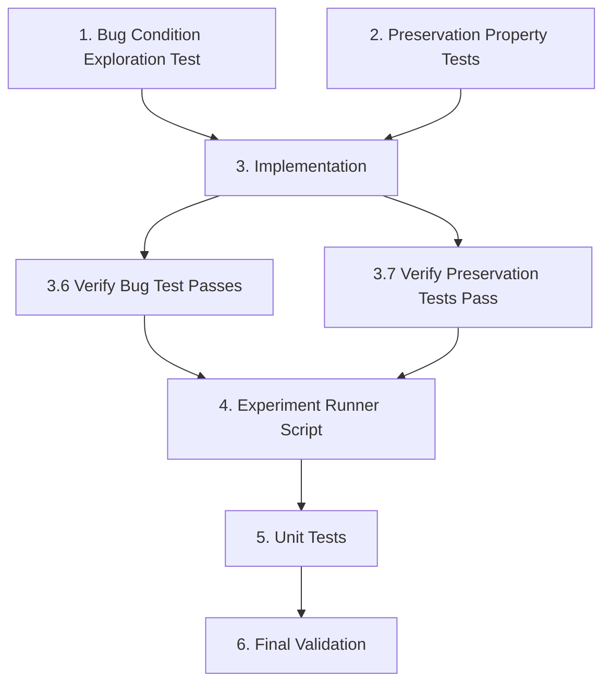

# Implementation Plan

## Task Dependency Graph



```json
{
  "waves": [
    {
      "wave": 1,
      "tasks": [1, 2],
      "description": "Exploration and preservation tests (parallel, before fix)"
    },
    {
      "wave": 2,
      "tasks": [3],
      "description": "Implementation of all three cold-start variants"
    },
    {
      "wave": 3,
      "tasks": [4, 5],
      "description": "Experiment runner and unit tests"
    },
    {
      "wave": 4,
      "tasks": [6],
      "description": "Final validation and integration testing"
    }
  ]
}
```

## Overview

This plan implements three cold-start optimized variants for UFM-Rec to address the performance gap on items with 1-5 training interactions (extreme_cold regime). Each variant forces the model to rely primarily on semantic embeddings for cold items while preserving collaborative filtering for warm items.

## Success Criteria

- Extreme Cold NDCG@10 >= 0.19 (matching or beating TF-IDF baseline)
- Cold Macro NDCG@10 >= 0.19
- Warm NDCG@10 >= 0.65 (no regression on warm items)
- All existing variants continue to work unchanged

---

## Tasks

### Phase 1: Bug Condition Exploration Tests

- [x] 1. Write bug condition exploration test
  - **Property 1: Bug Condition** - Cold Item CF Weight Analysis
  - **CRITICAL**: This test MUST FAIL on unfixed code - failure confirms the bug exists
  - **DO NOT attempt to fix the test or the code when it fails**
  - **NOTE**: This test encodes the expected behavior - it will validate the fix when it passes after implementation
  - **GOAL**: Surface counterexamples that demonstrate the bug exists
  - **Scoped PBT Approach**: Scope the property to items with train_count=1-5 (extreme_cold regime)
  - Test that for items where `1 <= train_count <= 5`, the CF weight remains > 0.3 (insufficient suppression)
  - Test that NDCG@10 for extreme_cold items is < 0.19 (below TF-IDF baseline)
  - Verify count_aware_fusion penalty of exp(-count/5) is insufficient (e.g., exp(-1/5) ≈ 0.82 doesn't suppress CF enough)
  - Run test on UNFIXED code
  - **EXPECTED OUTCOME**: Test FAILS (this is correct - it proves the bug exists)
  - Document counterexamples found (e.g., "item with train_count=2 has CF weight=0.45 instead of expected <= 0.1")
  - Mark task complete when test is written, run, and failure is documented
  - _Requirements: 1.1, 1.2, 1.3, 1.4_

---

### Phase 2: Preservation Property Tests

- [~] 2. Write preservation property tests (BEFORE implementing fix)
  - **Property 2: Preservation** - Warm Item and Zero-Shot Behavior
  - **IMPORTANT**: Follow observation-first methodology
  - Observe behavior on UNFIXED code for non-buggy inputs:
    - Warm items (train_count > 5): CF weight > 0.5, NDCG@10 >= 0.65
    - Zero-shot items (train_count = 0): Semantic-only processing (CF unavailable)
    - Empty user history: NDCG@10 = 0.000
  - Write property-based tests:
    - For all items with train_count > 5: scores match within tolerance after fix
    - For all items with train_count = 0: exact same behavior (semantic-only)
    - For empty user histories: same NDCG=0.000 behavior
  - Property-based testing generates many test cases for stronger guarantees
  - Run tests on UNFIXED code
  - **EXPECTED OUTCOME**: Tests PASS (this confirms baseline behavior to preserve)
  - Mark task complete when tests are written, run, and passing on unfixed code
  - _Requirements: 3.1, 3.2, 3.3, 3.4, 3.5_

---

### Phase 3: Implementation

- [ ] 3. Fix for cold-start performance gap

  - [~] 3.1 Add new configuration parameters to UFMConfig
    - Add `cold_threshold: int = 5` - threshold below which items are "cold"
    - Add `cold_alpha: float = 1.0` - strength of count-based prior for hybrid_confidence_gate
    - Add `cold_adapter_dim: int = 64` - hidden dimension for cold_adapter variant
    - Update variant validation to include `count_aware_hard`, `hybrid_confidence_gate`, `cold_adapter`
    - Add validation: cold_threshold >= 1, cold_alpha >= 0, cold_adapter_dim >= 1
    - _Bug_Condition: isBugCondition(input) where 1 <= input.train_count <= 5_
    - _Expected_Behavior: CF weight <= 0.1 for cold items, NDCG@10 >= 0.19_
    - _Preservation: Warm items (train_count > 5) use CF normally, zero-shot uses semantic-only_
    - _Requirements: 2.1, 2.2, 2.3_

  - [~] 3.2 Implement count_aware_hard variant
    - Add hard constraint logic after computing `cf_ok`:
      ```python
      if self.config.variant == "count_aware_hard":
          cold_candidates = train_counts[candidates] <= self.config.cold_threshold
          cf_ok = cf_ok & ~cold_candidates
      ```
    - This forces CF weight to 0 for items below threshold
    - Simple, predictable, no additional parameters
    - _Bug_Condition: isBugCondition(input) where train_count <= cold_threshold_
    - _Expected_Behavior: CF weight = 0 for cold items, semantic weight = 1.0_
    - _Preservation: Warm items (train_count > threshold) use CF unchanged_
    - _Requirements: 2.1, 2.2_

  - [~] 3.3 Implement hybrid_confidence_gate variant
    - Modify uncertainty computation after `u_cf` calculation:
      ```python
      if self.config.variant == "hybrid_confidence_gate":
          count_prior = self.config.cold_alpha * torch.exp(-train_counts[candidates].float() / self.config.cold_threshold)
          u_cf = u_cf + count_prior
      ```
    - Builds on existing count_aware_fusion pattern
    - Configurable strength via cold_alpha parameter
    - Softer transition for near-threshold items
    - _Bug_Condition: isBugCondition(input) where train_count <= cold_threshold_
    - _Expected_Behavior: u_cf increased by count_prior, forcing lower CF weight_
    - _Preservation: Warm items receive small/no penalty, CF weight preserved_
    - _Requirements: 2.1, 2.3_

  - [~] 3.4 Implement cold_adapter variant
    - Add cold adapter network in `__init__`:
      ```python
      if config.variant == "cold_adapter":
          self.cold_adapter = mlp(config.feature_dim * 2 + 2, config.cold_adapter_dim, config.dim)
      ```
    - Add cold-specific processing in `forward`:
      ```python
      if self.config.variant == "cold_adapter":
          cold_mask = train_counts[candidates] <= self.config.cold_threshold
          cold_sem = self.cold_adapter(torch.cat([sem_user, cs, modality_flags.float()], -1))
          sem = torch.where(cold_mask.unsqueeze(-1), cold_sem, sem)
      ```
    - Learns cold-specific representations
    - Potentially better adaptation to cold regime
    - _Bug_Condition: isBugCondition(input) where train_count <= cold_threshold_
    - _Expected_Behavior: cold_adapter network processes cold items, improving semantic representation_
    - _Preservation: Warm items use main adapter unchanged_
    - _Requirements: 2.1, 2.4_

  - [~] 3.5 Add command-line arguments to train_ufm_recommender.py
    - Add `--cold-threshold` (int, default=5)
    - Add `--cold-alpha` (float, default=1.0)
    - Add `--cold-adapter-dim` (int, default=64)
    - Update `--variant` choices to include new variants
    - Update UFMConfig creation to pass new parameters
    - Add validation: cold_threshold >= 1, cold_alpha >= 0, cold_adapter_dim >= 1
    - _Requirements: 2.1, 2.2, 2.3_

  - [~] 3.6 Verify bug condition exploration test now passes
    - **Property 1: Expected Behavior** - Cold Item CF Suppression
    - **IMPORTANT**: Re-run the SAME test from task 1 - do NOT write a new test
    - The test from task 1 encodes the expected behavior
    - When this test passes, it confirms the expected behavior is satisfied
    - Run bug condition exploration test from step 1
    - **EXPECTED OUTCOME**: Test PASSES (confirms bug is fixed)
    - For count_aware_hard: CF weight = 0 for train_count <= threshold
    - For hybrid_confidence_gate: CF weight <= 0.1 for train_count <= threshold
    - For cold_adapter: Semantic representation improved for cold items
    - _Requirements: 2.1, 2.2, 2.3, 2.4_

  - [~] 3.7 Verify preservation tests still pass
    - **Property 2: Preservation** - Warm Item and Zero-Shot Behavior
    - **IMPORTANT**: Re-run the SAME tests from task 2 - do NOT write new tests
    - Run preservation property tests from step 2
    - **EXPECTED OUTCOME**: Tests PASS (confirms no regressions)
    - Confirm all tests still pass after fix (no regressions)
    - Warm items: NDCG@10 >= 0.65
    - Zero-shot: Semantic-only processing unchanged
    - Empty history: NDCG=0.000 unchanged

- [ ] 4. Create experiment runner script
  - [~] 4.1 Create scripts/run_cold_start_experiments.py
    - Accept variant name and parameters as arguments
    - Load training data and features
    - Train model with specified variant
    - Evaluate on cold-start regimes
    - Output metrics to JSON
    - Support all three new variants
    - _Requirements: 2.1, 2.2, 2.3, 2.4, 2.5_

  - [~] 4.2 Create configs/cold_start_variants.json
    - Configuration for all cold-start variant experiments
    - Include threshold_values, alpha_values, adapter_dim_values
    - Define success_criteria (NDCG thresholds)
    - Document expected behavior for each variant
    - _Requirements: 2.1, 2.5_

- [ ] 5. Create unit tests
  - [~] 5.1 Create tests/test_cold_start_variants.py
    - `test_count_aware_hard_suppresses_cold()`: Verify CF weight = 0 for train_count <= threshold
    - `test_hybrid_confidence_gate_increases_uncertainty()`: Verify u_cf increased by count prior
    - `test_cold_adapter_routing()`: Verify correct adapter used based on train_count
    - `test_warm_item_preservation()`: Verify warm items produce same scores as original
    - `test_config_validation()`: Verify new config parameters validated correctly
    - `test_variant_backward_compatibility()`: Verify existing variants unchanged
    - _Requirements: 2.1, 2.2, 2.3, 3.1, 3.2, 3.3, 3.4, 3.5_

  - [~] 5.2 Run all unit tests
    - Ensure all tests pass
    - Document any edge cases discovered
    - _Requirements: All_

---

### Phase 4: Checkpoint

- [ ] 6. Final validation and integration testing
  - [~] 6.1 Run full training with count_aware_hard variant
    - Train model with count_aware_hard variant
    - Verify cold macro NDCG >= 0.19
    - Verify warm NDCG >= 0.65
    - _Requirements: 2.1, 2.5, 3.1, 3.5_

  - [~] 6.2 Run full training with hybrid_confidence_gate variant
    - Train model with hybrid_confidence_gate variant
    - Verify cold macro NDCG >= 0.19
    - Verify warm NDCG >= 0.65
    - _Requirements: 2.1, 2.5, 3.1, 3.5_

  - [~] 6.3 Run full training with cold_adapter variant
    - Train model with cold_adapter variant
    - Verify cold macro NDCG >= 0.19
    - Verify warm NDCG >= 0.65
    - _Requirements: 2.1, 2.5, 3.1, 3.5_

  - [~] 6.4 Compare all variants against TF-IDF baseline
    - Compare extreme_cold NDCG@10 across all variants
    - Compare cold macro NDCG@10 across all variants
    - Document best performing variant
    - _Requirements: 2.1, 2.5_

  - [~] 6.5 Ensure all tests pass
    - Run full test suite
    - Ensure all tests pass, ask the user if questions arise
    - Document final metrics and results
    - _Requirements: All_

---

## Notes

### Key Implementation Details

1. **count_aware_hard**: Simplest variant - just masks out CF for cold items. No new learnable parameters. Best for predictable behavior.

2. **hybrid_confidence_gate**: Builds on existing count_aware_fusion pattern. The `cold_alpha` parameter controls penalty strength. Expected to be most robust across datasets.

3. **cold_adapter**: Most complex - adds separate neural network for cold items. May overfit if not regularized properly. Use with caution.

### Testing Strategy

- Phase 1 (Bug Condition) tests MUST fail on unfixed code - this confirms the bug exists
- Phase 2 (Preservation) tests MUST pass on unfixed code - this confirms baseline behavior
- Phase 3 (Implementation) verifies both tests behave correctly after fix

### Risk Mitigation

- Warm item preservation is critical - any regression here invalidates the fix
- All existing variants must continue to work unchanged
- New parameters should have sensible defaults that don't break existing workflows
