# Báo cáo đồ án UFM Rec

> Nguồn nội dung của bản nộp theo mẫu Trường Đại học Văn Lang: [Word](../output/docx/UFM_Rec_Bao_Cao_Do_An_20261103.docx), [PDF](../output/pdf/UFM_Rec_Bao_Cao_Do_An_20261103.pdf), dựng bằng `python scripts/build_report_figures.py` rồi `python scripts/build_school_report_docx.py`. Nhóm chốt đồ án với các checkpoint và bằng chứng hiện có; số liệu chính là validation v3 (40.000 ca, 100 ứng viên/ca, seed 42), truy nguồn trong [bảng bằng chứng](../reports/nontraining_20261029/evidence.json). Vòng 15 lượt huấn luyện đa seed là hướng phát triển (mục 7.3), không phải kết quả đã có.

## UFM-Rec: Hệ Khuyến Nghị Sản Phẩm Cold-Start Đa Phương Thức Dựa Trên Độ Tin Cậy Học Được

- **Học phần**: Học máy ứng dụng
- **Giảng viên hướng dẫn**: Phan Hồ Viết Trường
- **Nhóm thực hiện**: Nguyễn Thành Phong, Trần An Kỳ, Nguyễn Hoàng Hải, Hân
- **Phiên bản**: 03/11/2026 — bản nộp, chốt với kết quả hiện có

---

### LỜI NÓI ĐẦU

Mỗi ngày, các sàn thương mại điện tử đưa lên hàng nghìn sản phẩm mới. Phần lớn chúng có tên, mô tả và ảnh đầy đủ nhưng gần như chưa có lượt mua nào. Với hệ khuyến nghị dựa trên hành vi, những sản phẩm này gần như vô hình: mô hình chưa có dữ liệu để học biểu diễn cho chúng, nên chúng hiếm khi xuất hiện trong danh sách gợi ý và vì thế càng khó tích lũy tương tác. Đây là bài toán khởi đầu lạnh (cold-start) ở phía sản phẩm (Schein và cộng sự, 2002).

Đề tài UFM-Rec khảo sát một hướng tiếp cận cụ thể cho bài toán này: kết hợp lịch sử hành vi của người dùng với đặc trưng văn bản và hình ảnh của sản phẩm do mô hình CLIP trích xuất, rồi để mô hình tự điều chỉnh mức tin cậy vào từng nguồn tín hiệu theo từng cặp người dùng – sản phẩm ứng viên. Nhóm đã xây dựng toàn bộ quy trình trên tập Amazon Reviews 2023 nhóm Toys & Games với 767.045 sản phẩm và khoảng 11,57 triệu tương tác: tiền xử lý, chia dữ liệu theo thời gian, trích xuất đặc trưng, huấn luyện trên GPU, đánh giá theo từng nhóm sản phẩm, hiệu chuẩn và một ứng dụng demo chạy trên toàn bộ catalog.

Báo cáo trình bày kết quả một cách trung thực. Trên giao thức đánh giá hiện hành, mô hình UFM đầy đủ chưa vượt hai đối chứng dựa trên nội dung là TF-IDF và nhánh ngữ nghĩa đứng riêng. Nhóm xem đây là một phát hiện thực nghiệm có giá trị: nó chỉ ra chính xác nhóm sản phẩm có 1–5 tương tác là nơi việc dung hợp hành vi đang gây hại, và định hướng cho các thí nghiệm tiếp theo đã được nhóm thiết kế sẵn.

Báo cáo gồm bảy chương. Chương 1 giới thiệu bài toán, mục tiêu và phạm vi. Chương 2 trình bày cơ sở lý thuyết. Chương 3 mô tả dữ liệu và thiết kế hệ thống. Chương 4 trình bày mô hình UFM-Rec và cách cài đặt, huấn luyện. Chương 5 là thực nghiệm và kết quả. Chương 6 mô tả hệ thống demo. Chương 7 kết luận và nêu hướng phát triển.

---

### TÓM TẮT ĐỀ TÀI (ABSTRACT)

Bài toán khởi đầu lạnh (cold-start) và đặc biệt là cực lạnh (extreme cold-start) là một trong những thách thức lâu dài của hệ thống gợi ý. Khi một sản phẩm mới xuất hiện trên sàn thương mại điện tử, các phương pháp lọc cộng tác (Collaborative Filtering – CF) và mô hình chuỗi hành vi (như SASRec, BERT4Rec) gặp hạn chế do thiếu tương tác để học biểu diễn định danh cho sản phẩm đó.

Đề tài xây dựng và thực nghiệm kiến trúc **UFM-Rec (Uncertainty-aware Fusion Model Recommender)**. Mô hình kết hợp biểu diễn đa phương thức đóng băng từ **CLIP ViT-B/32** (văn bản tên, mô tả và hình ảnh sản phẩm) với biểu diễn tuần tự của lịch sử tương tác qua một Transformer nhân quả. Hai nhánh được hợp nhất bằng **proxy độ tin cậy học được** và **cổng căn chỉnh chéo**, cho phép mạng điều tiết trọng số giữa nhánh ngữ nghĩa và nhánh hành vi theo mức khả dụng của từng nguồn tín hiệu.

Thực nghiệm dùng Amazon Reviews 2023 — Toys & Games (767.045 sản phẩm, 11.572.689 tương tác dương sau làm sạch, 6.158.534 người dùng), chia theo thời gian 80/10/10. Mô hình được huấn luyện 12 epoch trên GPU Quadro RTX 6000; checkpoint epoch 9 được chọn theo validation. Đánh giá chính dùng validation v3 cố định: 40.000 ca, mỗi ca 1 sản phẩm đúng và 99 sản phẩm âm, 10.000 ca cho mỗi nhóm zero-shot, cực lạnh, lạnh và ấm. Trên cùng bộ ứng viên, Cold macro NDCG@10 của TF-IDF là **0,195682**, semantic-only dùng CLIP **0,190036**, UFM full **0,182056**, popularity **0,042527**. Mô hình đầy đủ tốt hơn semantic-only ở nhóm có từ 6 tương tác trở lên nhưng thấp hơn rõ ở nhóm 1–5 tương tác (−0,024101). Hiệu chuẩn temperature scaling giảm ECE từ **0,082061** xuống **0,037478** trên phần validation dùng để kiểm tra. Demo trên Windows phục vụ toàn bộ catalog với checkpoint thật, đạt 6/6 ca API và 4/4 ca giao diện.

Các kết quả chỉ có một seed và validation v3 dùng lại quần thể đã tham gia chọn checkpoint nên mang tính thăm dò. Hai can thiệp theo số tương tác (count-aware fusion và adaptive ID dropout) đã được cài đặt, kiểm thử và khóa kế hoạch 15 lượt huấn luyện, là hướng phát triển của đồ án.

**Từ khóa:** hệ khuyến nghị, cold-start, đa phương thức, CLIP, Transformer, hợp nhất theo độ tin cậy, hiệu chuẩn.

---

### MỤC LỤC

1. [CHƯƠNG 1: GIỚI THIỆU ĐỀ TÀI](#chương-1-giới-thiệu-đề-tài)
2. [CHƯƠNG 2: CƠ SỞ LÝ THUYẾT](#chương-2-cơ-sở-lý-thuyết)
3. [CHƯƠNG 3: DỮ LIỆU VÀ PHÂN TÍCH THIẾT KẾ HỆ THỐNG](#chương-3-dữ-liệu-và-phân-tích-thiết-kế-hệ-thống)
4. [CHƯƠNG 4: MÔ HÌNH UFM-REC VÀ CÀI ĐẶT](#chương-4-mô-hình-ufm-rec-và-cài-đặt)
5. [CHƯƠNG 5: THỰC NGHIỆM VÀ KẾT QUẢ](#chương-5-thực-nghiệm-và-kết-quả)
6. [CHƯƠNG 6: HỆ THỐNG DEMO](#chương-6-hệ-thống-demo)
7. [CHƯƠNG 7: KẾT LUẬN VÀ HƯỚNG PHÁT TRIỂN](#chương-7-kết-luận-và-hướng-phát-triển)

---

### CHƯƠNG 1: GIỚI THIỆU ĐỀ TÀI

#### 1.1. Bối cảnh và lý do chọn đề tài

Thương mại điện tử đã trở thành kênh mua sắm chính của nhiều người tiêu dùng. Một sàn lớn có thể chứa hàng trăm nghìn đến hàng triệu sản phẩm, vượt xa khả năng duyệt thủ công của người mua. Hệ khuyến nghị giúp thu hẹp không gian lựa chọn đó bằng cách đề xuất một danh sách ngắn các sản phẩm phù hợp, và có ảnh hưởng trực tiếp tới trải nghiệm người dùng cũng như doanh thu của người bán.

Các hệ khuyến nghị phổ biến hiện nay chủ yếu học từ dữ liệu hành vi: lượt xem, lượt mua, đánh giá. Lọc cộng tác giả định rằng những người có hành vi giống nhau trong quá khứ sẽ có sở thích giống nhau trong tương lai; các mô hình tuần tự như SASRec hay BERT4Rec học thứ tự các sản phẩm người dùng đã tương tác để dự đoán sản phẩm tiếp theo. Cả hai hướng đều cần một lượng tương tác đủ lớn cho mỗi sản phẩm để học biểu diễn của nó.

Điều kiện này không thỏa với sản phẩm mới hoặc ít người mua. Trong dữ liệu của đề tài, 182.199 sản phẩm (23,8% catalog) không có tương tác nào trong tập huấn luyện và 388.352 sản phẩm khác (50,6%) chỉ có 1–5 tương tác. Như vậy phần lớn catalog nằm ở vùng mà biểu diễn hành vi gần như không có thông tin. Trong khi đó, mỗi sản phẩm lại có sẵn tên, mô tả và ảnh do người bán cung cấp ngay khi đăng bán.

Các mô hình nền tảng thị giác – ngôn ngữ như CLIP được huấn luyện trên hàng trăm triệu cặp ảnh – văn bản và có thể ánh xạ văn bản lẫn ảnh vào một không gian biểu diễn chung. Điều đó gợi ý một hướng giải quyết: dùng nội dung sản phẩm để bù cho phần hành vi còn thiếu. Câu hỏi khó hơn là **khi nào nên tin vào nội dung và khi nào nên tin vào hành vi**, vì nội dung không phản ánh đầy đủ sở thích cá nhân, còn hành vi thì thiếu ở đúng những sản phẩm cần gợi ý nhất. Đề tài UFM-Rec được chọn để khảo sát câu hỏi này bằng thực nghiệm trên dữ liệu thật, quy mô lớn.

#### 1.2. Phát biểu bài toán

Đề tài giải bài toán gợi ý sản phẩm tiếp theo (next-item recommendation) với phản hồi ngầm. Gọi $\mathcal{U}$ là tập người dùng và $\mathcal{I}$ là catalog sản phẩm. Với một người dùng $u$ tại thời điểm $t$, lịch sử của họ là chuỗi các sản phẩm đã tương tác trước đó, sắp theo thời gian:

$$S_u^{(t)} = (i_1, i_2, \dots, i_L), \qquad L \le 20 \qquad (1.1)$$

Mỗi sản phẩm $i$ có văn bản $x_i^{\text{txt}}$ (tên, đặc điểm, mô tả, cửa hàng, danh mục) và có thể có ảnh $x_i^{\text{img}}$. Cho một tập ứng viên $C \subseteq \mathcal{I}$, mô hình cần cho điểm $s(u, j)$ cho mọi $j \in C$ sao cho sản phẩm mà người dùng thực sự tương tác tiếp theo được xếp ở vị trí càng cao càng tốt trong danh sách $K$ phần tử đầu (đề tài dùng $K = 10$).

Một tương tác được coi là **dương** khi đó là lượt mua đã xác minh và có điểm đánh giá từ 4 sao trở lên. Bài toán được đánh giá theo từng nhóm sản phẩm đích, tùy số tương tác của sản phẩm đó trong tập huấn luyện (mục 1.3), vì mục tiêu của đề tài là hiểu hành vi của mô hình ở vùng dữ liệu thưa.

#### 1.3. Thách thức cold-start và các nhóm sản phẩm

Đề tài chia sản phẩm thành bốn nhóm theo số tương tác dương của chúng trong tập huấn luyện, ký hiệu $c_{\text{train}}(i)$. Các ngưỡng được cố định từ đầu và dùng thống nhất cho mọi bước chia dữ liệu, lấy mẫu và báo cáo.

*Bảng: Bốn nhóm sản phẩm theo số tương tác trong tập huấn luyện*

| Nhóm | Điều kiện | Số sản phẩm trong catalog | Đặc điểm |
| --------- | --------- | --------: | ------------------ |
| Zero-shot | $c_{\text{train}} = 0$ | 182.199 | Chưa từng xuất hiện trong train; không có biểu diễn hành vi |
| Extreme cold (cực lạnh) | $1 \le c_{\text{train}} \le 5$ | 388.352 | Có ID nhưng rất ít lần được cập nhật |
| Cold (lạnh) | $6 \le c_{\text{train}} \le 20$ | 120.002 | Bắt đầu có tín hiệu hành vi |
| Warm (ấm) | $c_{\text{train}} > 20$ | 76.492 | Nhiều tương tác; vùng mạnh của lọc cộng tác |

Ba thách thức chính của đề tài là:

1. **Dữ liệu thưa không đều.** Một mô hình phù hợp với sản phẩm ấm có thể hoạt động kém với sản phẩm cực lạnh, vì vector định danh của sản phẩm ít tương tác được học từ rất ít gradient. Cần đánh giá riêng từng nhóm thay vì chỉ nhìn chỉ số trung bình.
2. **Hợp nhất nguồn tín hiệu không đồng nhất.** Văn bản, ảnh và hành vi có độ tin cậy khác nhau theo từng sản phẩm. Ghép nối đơn giản có thể khiến một nguồn lấn át các nguồn còn lại.
3. **Độ tin cậy của điểm số.** Mạng nơ-ron thường tự tin quá mức. Điểm xếp hạng cần được hiểu đúng: nó là tín hiệu để sắp thứ tự trong một tập ứng viên, không phải xác suất mua hàng.

#### 1.4. Mục tiêu và câu hỏi nghiên cứu

Mục tiêu tổng quát của đề tài là xây dựng và đánh giá một hệ khuyến nghị kết hợp hành vi, văn bản và hình ảnh, có khả năng điều chỉnh trọng số giữa các nguồn tín hiệu theo mức khả dụng của chúng, cùng một giao thức đánh giá đủ chặt để trả lời các câu hỏi sau:

- **CH1.** Đặc trưng CLIP đóng băng (văn bản, ảnh, hoặc cả hai) đạt chất lượng xếp hạng thế nào so với đối chứng nội dung truyền thống TF-IDF, ở từng nhóm sản phẩm?
- **CH2.** Thêm nhánh hành vi và cơ chế hợp nhất theo độ tin cậy có cải thiện chất lượng so với chỉ dùng nhánh ngữ nghĩa không, và ở nhóm nào?
- **CH3.** Từng thành phần của kiến trúc (proxy độ tin cậy, căn chỉnh chéo, mỗi phương thức) đóng góp bao nhiêu, xét qua các thí nghiệm loại trừ (ablation)?
- **CH4.** Điểm số của mô hình có được hiệu chuẩn không, và temperature scaling thay đổi điều gì?

Mục tiêu kỹ thuật đi kèm gồm: quy trình dữ liệu tái lập được với mã băm cho từng đầu vào; huấn luyện chịu được gián đoạn trên máy chủ dùng chung; bộ kiểm thử tự động; và một ứng dụng demo chạy trên toàn bộ catalog với checkpoint thật.

#### 1.5. Phạm vi và giới hạn

Phạm vi được nhóm thống nhất với giảng viên hướng dẫn là **hệ khuyến nghị sản phẩm dùng lịch sử hành vi, hình ảnh và tên/mô tả sản phẩm**; cold-start sản phẩm là nhóm phân tích trọng tâm.

*Bảng: Phạm vi của đề tài*

| Trong phạm vi | Ngoài phạm vi |
| --- | --- |
| Gợi ý sản phẩm tiếp theo với phản hồi ngầm (mua đã xác minh, từ 4 sao) | Dự đoán điểm đánh giá, phân tích cảm xúc bình luận |
| Đánh giá riêng bốn nhóm zero-shot, cực lạnh, lạnh, ấm | Cá nhân hóa cho người dùng hoàn toàn mới (chỉ dùng fallback popularity) |
| CLIP ViT-B/32 đóng băng làm bộ trích xuất đặc trưng | Tinh chỉnh (fine-tune) CLIP, LoRA, encoder khác |
| Toys & Games là tập chính; All Beauty chuẩn bị dữ liệu và baseline | Huấn luyện UFM trên All Beauty, học chuyển miền |
| Xếp hạng trên tập 100 ứng viên mỗi ca | Truy hồi trên toàn catalog, đánh giá trực tuyến (A/B test) |

Do giới hạn thời gian và tài nguyên GPU dùng chung, các kết quả UFM trong báo cáo đều đến từ **một seed huấn luyện (42)**. Kế hoạch 15 lượt huấn luyện đa seed đã được thiết kế và khóa nhưng không chạy trong phạm vi đồ án (mục 7.3).

#### 1.6. Đóng góp của đồ án

Đồ án có các đóng góp sau, được phân biệt rõ với phần kế thừa:

- **Phần kế thừa.** CLIP ViT-B/32, Transformer nhân quả, hàm mất mát xếp hạng kiểu BPR, TF-IDF và temperature scaling là các phương pháp đã có; nhóm sử dụng chúng, không tuyên bố đề xuất mới.
- **Phần nhóm thiết kế và cài đặt.** Bộ chuyển đổi (adapter) đa phương thức có mặt nạ cho phương thức thiếu; cơ chế đánh dấu khả dụng cho từng nhánh; hai đầu ước lượng độ bất định dùng làm proxy độ tin cậy; hợp nhất có trọng số kèm căn chỉnh chéo có cổng; hai biến thể can thiệp theo số tương tác (count-aware fusion và adaptive ID dropout).
- **Quy trình thực nghiệm.** Chia dữ liệu theo thời gian ở quy mô 11,57 triệu tương tác; bộ ứng viên cố định có mã băm cho 40.000 ca cân bằng bốn nhóm; mười mô hình và biến thể được đánh giá trên cùng một bộ ứng viên; tách bạch ba phiên bản giao thức đánh giá v1, v2, v3.
- **Phát hiện thực nghiệm.** Mô hình đầy đủ chưa vượt đối chứng nội dung, và phần thua tập trung ở nhóm 1–5 tương tác. Đây là chỉ dẫn cụ thể cho hướng cải tiến tiếp theo.
- **Hệ thống.** Ứng dụng demo chạy trên 767.045 sản phẩm với checkpoint thật; bộ 123 ca kiểm thử tự động; quy trình sao lưu và khôi phục có kiểm tra SHA-256.

#### 1.7. Quy trình thực hiện và tiến độ

Đồ án được thực hiện trong khoảng tháng 9 đến đầu tháng 11 năm 2026, theo các giai đoạn trong Bảng 1.3. Mốc thời gian được đối chiếu với các báo cáo tiến độ có ngày trong thư mục `docs/history/` và lịch sử Git.

*Bảng: Các giai đoạn thực hiện đồ án*

| Giai đoạn | Thời gian | Công việc chính | Kết quả |
| --------- | --------- | ------------------ | --------------- |
| 1. Dữ liệu | Tháng 9/2026 | Tải Amazon Reviews 2023, lọc tương tác, chia theo thời gian, dựng catalog và TF-IDF | 11.572.689 tương tác, catalog 767.045 sản phẩm |
| 2. Đặc trưng | Cuối tháng 9 – đầu tháng 10/2026 | Trích xuất CLIP văn bản và ảnh trên GPU FITLAB | 767.044 vector văn bản, 758.692 vector ảnh |
| 3. Huấn luyện | Đầu tháng 10/2026 | Huấn luyện UFM full, sau đó bảy biến thể ablation | Checkpoint epoch 9; bảy biến thể một seed |
| 4. Kiểm định | Cuối tháng 10/2026 | Sửa giao thức đánh giá (v2, v3), hiệu chuẩn, đánh giá lại tám checkpoint | Bộ bằng chứng validation v3 có mã băm |
| 5. Ứng dụng và bàn giao | 28/10 – 03/11/2026 | Demo trên toàn catalog, kiểm thử, sao lưu, báo cáo và slide | 6/6 ca API, 4/4 ca giao diện, 120 test đạt |

#### 1.8. Cấu trúc báo cáo

Phần còn lại của báo cáo được tổ chức như sau. Chương 2 trình bày cơ sở lý thuyết về hệ khuyến nghị, mô hình tuần tự, CLIP, các chỉ số đánh giá và hiệu chuẩn. Chương 3 mô tả dữ liệu, quy trình tiền xử lý và kiến trúc tổng thể của hệ thống. Chương 4 trình bày chi tiết mô hình UFM-Rec, hàm mất mát, quá trình huấn luyện và kiểm thử. Chương 5 báo cáo kết quả thực nghiệm, phân tích theo nhóm sản phẩm, ablation, hiệu chuẩn và tài nguyên. Chương 6 mô tả hệ thống demo và kết quả nghiệm thu. Chương 7 tổng kết, nêu hạn chế và hướng phát triển.

---

### CHƯƠNG 2: CƠ SỞ LÝ THUYẾT

#### 2.1. Tổng quan về hệ khuyến nghị

Hệ khuyến nghị dự đoán mức độ phù hợp giữa người dùng và sản phẩm để đề xuất một danh sách ngắn. Có ba họ phương pháp chính:

- **Dựa trên nội dung (content-based):** biểu diễn sản phẩm bằng thuộc tính của nó (văn bản, ảnh, danh mục) và gợi ý sản phẩm giống với những gì người dùng đã thích. Ưu điểm là dùng được cho sản phẩm mới; nhược điểm là khó nắm bắt sở thích không thể hiện qua nội dung.
- **Lọc cộng tác (collaborative filtering):** học từ ma trận tương tác giữa người dùng và sản phẩm, không cần nội dung. Mạnh khi dữ liệu dày, nhưng không có thông tin về sản phẩm chưa có tương tác.
- **Lai (hybrid):** kết hợp hai nguồn trên. UFM-Rec thuộc họ này; điểm đặc thù là trọng số giữa hai nguồn được học và thay đổi theo từng cặp người dùng – ứng viên.

Dữ liệu của đề tài là **phản hồi ngầm**: hệ thống chỉ quan sát được các lượt mua, không có tín hiệu "không thích" tường minh. Vì vậy bài toán được đặt dưới dạng xếp hạng: sản phẩm người dùng thực sự mua cần được xếp cao hơn các sản phẩm khác lấy làm mẫu âm.

#### 2.2. Lọc cộng tác, phân rã ma trận và BPR

Phân rã ma trận (Matrix Factorization – MF; Koren và cộng sự, 2009) biểu diễn mỗi người dùng $u$ và sản phẩm $i$ bằng vector ẩn $\mathbf{p}_u, \mathbf{q}_i \in \mathbb{R}^d$ và ước lượng mức độ phù hợp bằng tích vô hướng $\hat{y}_{ui} = \mathbf{p}_u^{\top}\mathbf{q}_i$. Với phản hồi ngầm, Bayesian Personalized Ranking (BPR) của Rendle và cộng sự tối ưu trực tiếp thứ tự giữa một sản phẩm dương $i$ và một sản phẩm âm $j$:

$$\mathcal{L}_{\text{BPR}} = -\sum_{(u,i,j)} \ln \sigma\left(\hat{y}_{ui} - \hat{y}_{uj}\right) + \lambda \lVert \Theta \rVert^2 \qquad (2.1)$$

trong đó $\sigma$ là hàm sigmoid. Vì $-\ln\sigma(x) = \operatorname{softplus}(-x)$, hàm mất mát xếp hạng của UFM-Rec (mục 4.6) có cùng dạng với BPR, chỉ khác ở cách tính điểm. Nhóm đã huấn luyện BPR-MF với ba seed làm đối chứng lịch sử (mục 5.9). Hạn chế cốt lõi của MF là vector $\mathbf{q}_i$ của sản phẩm chưa có tương tác không được học, nên MF không thể xếp hạng có ý nghĩa cho sản phẩm zero-shot.

#### 2.3. Mô hình tuần tự và Transformer nhân quả

Gợi ý tuần tự coi lịch sử người dùng là một chuỗi có thứ tự và dự đoán phần tử tiếp theo. SASRec (Kang và McAuley, 2018) dùng cơ chế tự chú ý (self-attention) của Transformer (Vaswani và cộng sự, 2017) trên chuỗi ID sản phẩm. Với ma trận truy vấn $Q$, khóa $K$, giá trị $V$ thu được từ chuỗi đầu vào, phép chú ý tích vô hướng có chuẩn hóa là:

$$\operatorname{Attention}(Q,K,V) = \operatorname{softmax}\left(\frac{QK^{\top}}{\sqrt{d_k}} + M\right)V \qquad (2.2)$$

trong đó $M$ là mặt nạ nhân quả: $M_{ab} = -\infty$ khi $b > a$, nên mỗi vị trí chỉ nhìn được các vị trí trước nó. Nhờ vậy mô hình không thể "nhìn trước" sản phẩm tương lai khi huấn luyện. BERT4Rec (Sun và cộng sự, 2019) dùng chú ý hai chiều với mục tiêu che từ (Cloze); nhánh hành vi của UFM-Rec dùng chú ý nhân quả giống SASRec. Cả hai mô hình đều phụ thuộc vào embedding ID của sản phẩm, nên có cùng điểm yếu với MF ở vùng cold-start.

#### 2.4. Biểu diễn văn bản bằng TF-IDF

TF-IDF là biểu diễn văn bản kinh điển (Salton và Buckley, 1988): trọng số của từ $w$ trong văn bản $d$ tăng theo tần suất xuất hiện trong văn bản và giảm theo số văn bản chứa từ đó:

$$\operatorname{tfidf}(w,d) = \left(1 + \ln \operatorname{tf}(w,d)\right) \cdot \left(\ln\frac{1 + N}{1 + \operatorname{df}(w)} + 1\right) \qquad (2.3)$$

Đề tài dùng dạng tf tuyến tính hóa bằng logarit (sublinear tf), IDF làm trơn và chuẩn hóa L2 theo cấu hình của scikit-learn (Pedregosa và cộng sự, 2011). Độ tương đồng giữa hai sản phẩm là cosine của hai vector TF-IDF. Đối chứng TF-IDF của đề tài xây dựng hồ sơ người dùng từ 10 sản phẩm gần nhất trong lịch sử và xếp hạng ứng viên theo độ tương đồng với hồ sơ đó (mục 5.2). TF-IDF không dùng ảnh, nhưng khai thác tốt các từ khóa đặc thù như thương hiệu, dòng sản phẩm, số hiệu bộ LEGO.

#### 2.5. Mô hình nền tảng thị giác – ngôn ngữ CLIP

CLIP (Radford và cộng sự, 2021) gồm một bộ mã hóa ảnh và một bộ mã hóa văn bản, được huấn luyện đồng thời trên khoảng 400 triệu cặp ảnh – chú thích bằng học tương phản. Với một lô $N$ cặp, sau khi chuẩn hóa L2 các vector ảnh $\mathbf{v}_k$ và văn bản $\mathbf{t}_k$, mô hình tối đa hóa độ tương đồng của cặp đúng so với các cặp sai:

$$\mathcal{L}_{\text{CLIP}} = -\frac{1}{2N}\sum_{k=1}^{N}\left[\ln\frac{e^{\langle \mathbf{v}_k,\mathbf{t}_k\rangle/\tau}}{\sum_{m} e^{\langle \mathbf{v}_k,\mathbf{t}_m\rangle/\tau}} + \ln\frac{e^{\langle \mathbf{v}_k,\mathbf{t}_k\rangle/\tau}}{\sum_{m} e^{\langle \mathbf{v}_m,\mathbf{t}_k\rangle/\tau}}\right] \qquad (2.4)$$

Kết quả là văn bản và ảnh cùng nằm trong một không gian biểu diễn, nơi các khái niệm giống nhau ở gần nhau. Đề tài dùng biến thể ViT-B/32 (bộ mã hóa ảnh Vision Transformer của Dosovitskiy và cộng sự, 2021, với các ô ảnh 32×32 điểm), cho vector 512 chiều cho cả ảnh và văn bản. CLIP được **đóng băng**: nhóm chỉ trích xuất đặc trưng một lần rồi lưu lại, không tinh chỉnh. Cách làm này giảm mạnh chi phí huấn luyện và giữ nguyên không gian biểu diễn tổng quát, đổi lại biểu diễn không được điều chỉnh riêng cho miền đồ chơi. Bộ mã hóa văn bản của CLIP giới hạn 77 token, nên mô tả dài bị cắt.

#### 2.6. Hợp nhất đa nguồn và ước lượng độ tin cậy

Khi có nhiều nguồn tín hiệu, cách đơn giản nhất là cộng điểm với trọng số cố định, hoặc ghép nối các vector rồi đưa qua một mạng. Trọng số cố định không thích ứng được với từng sản phẩm: cùng một trọng số cho nhánh hành vi là hợp lý với sản phẩm ấm nhưng có hại với sản phẩm cực lạnh. Các cơ chế cổng (gating) học trọng số phụ thuộc đầu vào, ví dụ qua một hàm softmax trên đầu ra của một mạng nhỏ.

Một hướng khác là gắn mỗi nguồn với một đại lượng **độ bất định**: nguồn nào bất định hơn thì nhận trọng số nhỏ hơn. Trong các mô hình xác suất, độ bất định có thể được ước lượng theo nghĩa Bayes (ví dụ Kendall và Gal, 2017 phân biệt độ bất định do dữ liệu và do mô hình). UFM-Rec dùng một dạng đơn giản hơn: mỗi nhánh có một đầu dự đoán dương (qua hàm Softplus) được huấn luyện để khớp với sai số bình phương của chính nhánh đó. Đại lượng này là **proxy độ tin cậy học được**, có ích để điều tiết trọng số, nhưng **không phải hậu nghiệm Bayes** và không nên diễn giải như xác suất.

#### 2.7. Đánh giá hệ khuyến nghị

Với mỗi ca đánh giá có đúng một sản phẩm đích trong tập ứng viên, gọi $r$ là thứ hạng (bắt đầu từ 1) của sản phẩm đích sau khi sắp ứng viên theo điểm giảm dần. Ba chỉ số chính ở mức cắt $K = 10$ là (NDCG theo Järvelin và Kekäläinen, 2002):

$$\operatorname{Recall@}K = \mathbb{I}(r \le K) \qquad (2.5)$$

$$\operatorname{MRR@}K = \frac{\mathbb{I}(r \le K)}{r} \qquad (2.6)$$

$$\operatorname{NDCG@}K = \frac{\mathbb{I}(r \le K)}{\log_2(r + 1)} \qquad (2.7)$$

Các chỉ số được lấy trung bình trên tất cả các ca. Với một sản phẩm đích duy nhất, IDCG bằng 1 nên NDCG@K đơn giản thành công thức (2.7): sản phẩm đích ở vị trí 1 cho điểm 1, ở vị trí 10 cho điểm khoảng 0,289, ngoài top 10 cho điểm 0. Chỉ số chính của đề tài là **Cold macro NDCG@10**, trung bình cộng NDCG@10 của ba nhóm zero-shot, cực lạnh và lạnh, mỗi nhóm có trọng số bằng nhau:

$$\text{Cold macro} = \frac{1}{3}\left(\text{NDCG}_{\text{zero}} + \text{NDCG}_{\text{extreme}} + \text{NDCG}_{\text{cold}}\right) \qquad (2.8)$$

Đánh giá trên **tập ứng viên lấy mẫu** (1 đích + 99 âm) rẻ hơn nhiều so với xếp hạng toàn bộ catalog 767.045 sản phẩm, nhưng Krichene và Rendle (2020) đã chỉ ra rằng chỉ số trên tập lấy mẫu có thể không bảo toàn thứ tự giữa các mô hình so với chỉ số trên toàn catalog. Vì vậy các kết quả của đề tài được diễn giải là so sánh trên cùng một bộ ứng viên cố định, không phải chất lượng xếp hạng toàn catalog.

#### 2.8. Hiệu chuẩn và temperature scaling

Một mô hình được hiệu chuẩn tốt khi độ tự tin của nó khớp với tần suất đúng thực tế: trong các ca mô hình tự tin 70%, nó nên đúng khoảng 70%. Với điểm $s_j$ trên tập ứng viên $C$, xác suất top-1 được định nghĩa bằng softmax trên tập ứng viên, có thêm nhiệt độ $T > 0$:

$$p_j = \frac{\exp(s_j / T)}{\sum_{k \in C}\exp(s_k / T)} \qquad (2.9)$$

Sai số hiệu chuẩn kỳ vọng (Expected Calibration Error – ECE) chia các ca thành $M$ khoảng theo độ tự tin của dự đoán top-1, rồi lấy trung bình có trọng số chênh lệch giữa độ chính xác và độ tự tin trong từng khoảng:

$$\operatorname{ECE} = \sum_{m=1}^{M}\frac{|B_m|}{n}\left|\operatorname{acc}(B_m) - \operatorname{conf}(B_m)\right| \qquad (2.10)$$

Đề tài dùng $M = 15$ khoảng, cùng với log-likelihood âm (NLL) và điểm Brier đa lớp. Temperature scaling (Guo và cộng sự, 2017) chọn $T$ cực tiểu NLL trên một phần dữ liệu và áp dụng cho phần còn lại. Vì phép chia cho $T$ không đổi thứ tự điểm, temperature scaling **không thay đổi** NDCG, Recall hay MRR; nó chỉ làm cho độ tự tin đáng tin hơn. Trong đề tài, xác suất này là xác suất có điều kiện trên 100 ứng viên, không phải xác suất mua hàng.

#### 2.9. So sánh các hướng tiếp cận bài toán cold-start

*Bảng: So sánh các hướng tiếp cận được dùng hoặc đối chiếu trong đề tài*

| Phương pháp | Cơ chế | Điểm mạnh | Hạn chế với cold-start |
| --------- | ------------ | ------------ | --------------- |
| Popularity | Xếp theo số tương tác trong train | Đơn giản, luôn có kết quả | Không cá nhân hóa; mọi sản phẩm zero-shot cùng điểm 0, không phân biệt được |
| TF-IDF | Cosine giữa hồ sơ văn bản và ứng viên | Không cần tương tác; bắt tốt từ khóa đặc thù | Không dùng ảnh; không học sở thích ngoài nội dung |
| BPR-MF, SVD | Vector ẩn từ ma trận tương tác | Mạnh với sản phẩm nhiều tương tác | Không có biểu diễn cho sản phẩm zero-shot |
| SASRec, BERT4Rec | Tự chú ý trên chuỗi ID | Nắm bắt thứ tự hành vi | Phụ thuộc embedding ID như MF |
| CLIP semantic-only | Đặc trưng văn bản và ảnh đóng băng | Dùng được cho mọi sản phẩm có nội dung | Không học tín hiệu hành vi |
| UFM-Rec | Hai nhánh hợp nhất theo proxy độ tin cậy | Về nguyên tắc dùng được cả hai nguồn | Cần kiểm chứng; trong đề tài chưa vượt TF-IDF và semantic-only |

---

### CHƯƠNG 3: DỮ LIỆU VÀ PHÂN TÍCH THIẾT KẾ HỆ THỐNG

#### 3.1. Bộ dữ liệu Amazon Reviews 2023

Đề tài dùng bộ Amazon Reviews 2023 do nhóm McAuley Lab (UC San Diego) công bố, gồm đánh giá và metadata sản phẩm của nhiều ngành hàng. Nhóm chọn **Toys & Games** làm tập thực nghiệm chính vì đây là ngành hàng giàu tính đa phương thức: hình dáng, màu sắc trên ảnh quan trọng ngang với thông tin trong tên và mô tả (độ tuổi, số mảnh, thương hiệu, dòng sản phẩm). Hai nguồn được dùng là tệp đánh giá `Toys_and_Games.jsonl.gz` (mỗi dòng là một lượt đánh giá có người dùng, sản phẩm, điểm sao, thời điểm và cờ mua đã xác minh) và metadata sản phẩm (tên, đặc điểm, mô tả, cửa hàng, danh mục, đường dẫn ảnh). Metadata có bản Parquet chính thức trên Hugging Face; script `scripts/download_toys_metadata.py` tải năm phân đoạn và kiểm tra kích thước, SHA-256 đã ghim trước khi dùng.

*Bảng: Thống kê bộ dữ liệu Toys & Games sau từng bước lọc*

| Chỉ số | Giá trị |
| --- | ---: |
| Bản ghi đánh giá thô | 16.260.406 |
| Mua đã xác minh và từ 4 sao (tương tác dương) | 11.694.415 |
| Chưa xác minh mua hàng (bị loại) | 1.401.211 |
| Đã xác minh nhưng dưới 4 sao (bị loại) | 3.164.780 |
| Bản ghi trùng lặp hoàn toàn (bị loại) | 121.726 |
| **Tương tác dương giữ lại** | **11.572.689** |
| Người dùng khác nhau | 6.158.534 |
| Sản phẩm trong catalog | 767.045 |

Nguồn: [`split_manifest.json`](../data/processed/toys_games_full_temporal/split_manifest.json). Phân bố điểm sao trong dữ liệu thô lệch mạnh về phía tích cực: 10.960.709 đánh giá 5 sao (67,4%), 1.797.010 đánh giá 4 sao, 1.103.648 đánh giá 3 sao, 767.908 đánh giá 2 sao và 1.631.131 đánh giá 1 sao. Ma trận tương tác rất thưa: trung bình mỗi người dùng chỉ có khoảng 1,9 tương tác dương.

#### 3.2. Tiền xử lý và lọc tương tác

Quy tắc tiền xử lý được ghi trong manifest và áp dụng giống nhau cho cả hai bộ dữ liệu:

1. **Tương tác dương:** chỉ giữ lượt mua đã xác minh (`verified_purchase = true`) có điểm từ 4 sao. Đánh giá thấp có thể vẫn là lượt mua, nhưng không phản ánh sở thích tích cực, nên không dùng làm tín hiệu dương.
2. **Khử trùng lặp:** loại các bản ghi trùng hoàn toàn về người dùng, sản phẩm cha, điểm và thời điểm.
3. **Ánh xạ sản phẩm:** dùng mã sản phẩm cha (parent ASIN) để gộp các biến thể (màu, kích cỡ) của cùng một sản phẩm, rồi ánh xạ sang chỉ số nguyên liên tục.
4. **Lịch sử:** với mỗi tương tác, lịch sử là các tương tác dương **trước** nó của cùng người dùng; các sự kiện cùng thời điểm không nhìn thấy nhau. Hệ thống giữ tối đa 50 sản phẩm gần nhất; mô hình UFM dùng 20 sản phẩm gần nhất.

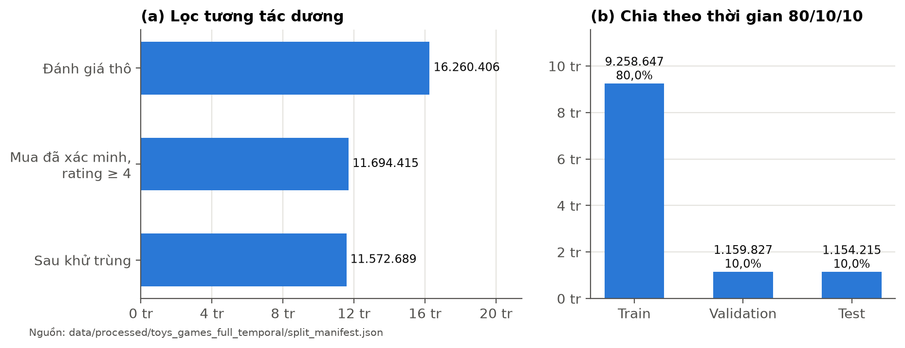

#### 3.3. Chia dữ liệu theo thời gian

Nhiều nghiên cứu chia dữ liệu ngẫu nhiên hoặc giữ lại tương tác cuối của mỗi người dùng (leave-one-out). Cách chia đó cho phép mô hình học từ các tương tác xảy ra **sau** thời điểm cần dự đoán, gây rò rỉ thông tin tương lai. Đề tài chia **theo thời gian toàn cục**: sắp xếp mọi tương tác theo thời điểm rồi cắt ở các mốc ngày (UTC) sao cho khoảng 80% thuộc tập huấn luyện, 10% thuộc validation và 10% thuộc test.

*Bảng: Kết quả chia dữ liệu Toys & Games theo thời gian*

| Tập | Mốc thời gian | Tương tác | Tỷ lệ | Sản phẩm khác nhau | Người dùng |
| --- | --- | ---: | ---: | ---: | ---: |
| Train | trước 11/08/2021 | 9.258.647 | 80,00% | 584.846 | 5.027.680 |
| Validation | 11/08/2021 – 15/07/2022 | 1.159.827 | 10,02% | 221.259 | 852.317 |
| Test | từ 16/07/2022 | 1.154.215 | 9,97% | 237.011 | 807.538 |

Trong tập huấn luyện, 4.230.848 tương tác có lịch sử khác rỗng và được dùng làm mẫu huấn luyện cho mô hình tuần tự. Ở validation, 574.622 tương tác (49,5%) đến từ người dùng chưa có lịch sử nào trước đó; ở test con số này là 556.232. Lịch sử của validation và test được phép chứa các sự kiện sớm hơn trong chính tập đó (kiểu đánh giá trực tuyến), nhưng không bao giờ chứa sự kiện ở tương lai.

Chia theo thời gian cũng có giới hạn. Metadata sản phẩm là ảnh chụp tại thời điểm công bố bộ dữ liệu, nên có thể chứa chỉnh sửa sau thời điểm tương tác; không có dấu thời gian lịch sử cho ảnh hay mô tả. Bộ ứng viên đánh giá (mục 5.1) dùng thống kê đến cuối mỗi tập, nên có tính hồi cứu.

#### 3.4. Phân nhóm sản phẩm theo số tương tác

Số tương tác train của mỗi sản phẩm quyết định nhóm của nó (Bảng 1.1). Hình 3.2 cho thấy hai góc nhìn khác nhau: catalog bị chi phối bởi sản phẩm ít tương tác, trong khi phần lớn tương tác validation lại rơi vào sản phẩm ấm.

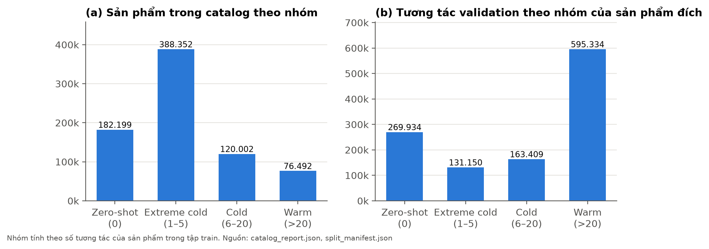

*Bảng: Số tương tác validation và test theo nhóm của sản phẩm đích*

| Nhóm | Validation | Tỷ lệ | Test | Tỷ lệ |
| --- | ---: | ---: | ---: | ---: |
| Zero-shot | 269.934 | 23,3% | 527.084 | 45,7% |
| Extreme cold | 131.150 | 11,3% | 89.818 | 7,8% |
| Cold | 163.409 | 14,1% | 112.385 | 9,7% |
| Warm | 595.334 | 51,3% | 424.928 | 36,8% |
| Tổng | 1.159.827 | 100% | 1.154.215 | 100% |

Tỷ lệ zero-shot tăng từ 23,3% ở validation lên 45,7% ở test, vì càng xa mốc cắt train càng có nhiều sản phẩm mới. Điều này cho thấy năng lực xử lý sản phẩm mới quan trọng thế nào khi hệ thống vận hành lâu dài. Vì phân bố tự nhiên lệch mạnh, giao thức đánh giá của đề tài lấy **cân bằng 10.000 ca cho mỗi nhóm**, để chỉ số của nhóm lạnh không bị nhóm ấm lấn át.

#### 3.5. Catalog nội dung: văn bản và ảnh

Catalog được dựng bằng cách quét 890.874 dòng metadata và khớp được đủ 767.045 sản phẩm. Với mỗi sản phẩm, hệ thống dựng hai trường nội dung:

- **Văn bản:** ghép các trường tên, đặc điểm, mô tả, cửa hàng và danh mục; loại thẻ HTML, script và style; giải mã thực thể HTML; chuẩn hóa Unicode NFC; loại ký tự vô hình và gộp khoảng trắng. Độ dài trung bình 985,73 ký tự, dài nhất 38.316 ký tự; chỉ một sản phẩm có văn bản rỗng.
- **Ảnh:** chọn một đường dẫn ảnh chính (ưu tiên ảnh MAIN) cho mỗi sản phẩm, không dùng ảnh của người đánh giá. 767.007 sản phẩm có đường dẫn ảnh; có đường dẫn chưa chắc tải được ảnh, nên độ phủ thực tế được đo ở bước trích xuất CLIP.

*Bảng: Cấu hình biểu diễn TF-IDF*

| Tham số | Giá trị |
| --- | --- |
| Số đặc trưng tối đa | 20.000 |
| N-gram | từ đơn và cặp từ (1, 2) |
| Tần suất văn bản tối thiểu | 2 |
| Biến đổi tf | tuyến tính hóa logarit (sublinear) |
| Chuẩn hóa | L2, chữ thường |
| Dữ liệu dùng để học từ vựng và IDF | 584.845 sản phẩm có tương tác train |
| Ma trận kết quả | 767.045 × 20.000; 100.678.550 giá trị khác 0 |

TF-IDF chỉ học từ vựng trên sản phẩm có trong train, rồi biến đổi mọi sản phẩm bằng từ vựng đã đóng băng, để thống kê của sản phẩm tương lai không rò rỉ vào biểu diễn. Sau biến đổi, chỉ 101 sản phẩm có vector toàn 0 (74 ở nhóm cực lạnh, 15 zero-shot, 11 lạnh, 1 ấm). Nguồn: [`content_report.json`](../data/processed/toys_games_full_temporal/content/content_report.json).

#### 3.6. Trích xuất đặc trưng CLIP

Nhóm trích xuất đặc trưng bằng CLIP ViT-B/32 với phiên bản mô hình được ghim, chạy trên GPU của FITLAB. Văn bản được cắt theo giới hạn 77 token của CLIP; ảnh được tải, giải mã và tiền xử lý theo chuẩn của CLIP. Mỗi sản phẩm có một vector văn bản và một vector ảnh 512 chiều, chuẩn hóa L2. Kết quả được lưu một lần thành bảng đặc trưng và dùng lại cho mọi lượt huấn luyện, đánh giá và demo; CLIP không được cập nhật trong quá trình huấn luyện.

*Bảng: Độ phủ đặc trưng CLIP trên catalog Toys & Games*

| Đặc trưng | Số sản phẩm | Tỷ lệ catalog |
| --- | ---: | ---: |
| Có vector văn bản | 767.044 | 99,99% |
| Có vector ảnh (tải và giải mã thành công) | 758.692 | 98,91% |
| Thiếu cả văn bản lẫn ảnh | 0 | 0% |

Sản phẩm thiếu ảnh hoặc thiếu văn bản được đánh dấu bằng **mặt nạ phương thức** $m \in \{0,1\}^2$ thay vì điền nhiễu ngẫu nhiên. Bản kiểm tra sau trích xuất xác nhận mọi giá trị hữu hạn, đã chuẩn hóa và đúng mặt nạ (`feature_audit.json` của lượt huấn luyện).

#### 3.7. Bộ dữ liệu thứ hai: All Beauty

Để chuẩn bị kiểm chứng trên miền thứ hai, nhóm xử lý bộ All Beauty bằng cùng quy trình và cùng chính sách chia 80/10/10.

*Bảng: Thống kê bộ dữ liệu All Beauty*

| Chỉ số | Giá trị |
| --- | ---: |
| Bản ghi đánh giá thô | 701.528 |
| Mua đã xác minh và từ 4 sao | 449.726 |
| Tương tác dương giữ lại sau khử trùng | 445.239 |
| Người dùng khác nhau | 419.423 |
| Sản phẩm trong catalog | 86.014 |
| Tương tác train / validation / test | 356.402 / 44.396 / 44.441 |
| Mốc validation / test | 18/04/2021 / 27/12/2021 |
| Độ dài văn bản trung bình | 298,9 ký tự |

All Beauty thưa hơn Toys & Games rất nhiều: phần lớn người dùng chỉ có một tương tác, nên đa số ca validation không có lịch sử. Trong phạm vi đồ án, All Beauty có dữ liệu và baseline (mục 5.10), chưa có mô hình UFM được huấn luyện.

#### 3.8. Phân tích yêu cầu hệ thống

Bảng dưới liệt kê các yêu cầu đặt ra cho hệ thống và mức đáp ứng thực tế đã được kiểm chứng bằng bằng chứng trong repo. Những yêu cầu chưa đạt được ghi rõ.

*Bảng: Yêu cầu chức năng, phi chức năng và mức đáp ứng*

| Mã | Yêu cầu | Mức đáp ứng |
| ------ | --------------------- | ------------------ |
| CN-01 | Gợi ý Top-K từ lịch sử 1–20 sản phẩm do người dùng chọn | Đạt: 6/6 ca API trên catalog thật |
| CN-02 | Gợi ý được sản phẩm zero-shot dựa trên nội dung | Đạt: ca zero-shot trên API và giao diện |
| CN-03 | Xử lý sản phẩm thiếu ảnh hoặc thiếu văn bản | Đạt: mặt nạ phương thức, có kiểm thử riêng |
| CN-04 | Hiển thị nhóm sản phẩm, trọng số nhánh, xuất kết quả JSON | Đạt: kiểm tra giao diện tự động |
| CN-05 | Từ chối lịch sử không hợp lệ thay vì trả kết quả giả | Đạt: lịch sử toàn sản phẩm lạ trả HTTP 400 |
| PCN-01 | Tái lập: mọi đầu vào có mã băm, không ghi đè kết quả cũ | Đạt: manifest SHA-256, kiểm thử chặn ghi đè |
| PCN-02 | Huấn luyện chịu được gián đoạn trên máy chủ dùng chung | Đạt: checkpoint mỗi 1.000 bước và resume |
| PCN-03 | Bảo mật demo: chỉ phục vụ nội bộ, kiểm tra nguồn gọi | Đạt: chỉ lắng nghe loopback, từ chối origin lạ |
| PCN-04 | Độ trễ phù hợp tương tác trực tiếp | Chưa đạt: p50 21,25 giây trên CPU (mục 5.11) |
| PCN-05 | Kiểm thử tự động cho các thành phần chính | Đạt: 123 ca kiểm thử, 120 đạt trên Windows |

#### 3.9. Kiến trúc tổng thể và luồng xử lý

Hệ thống được tổ chức thành bốn giai đoạn nối tiếp nhau (Hình 3.3). Mỗi giai đoạn ghi đầu ra cùng một tệp báo cáo có mã băm của đầu vào, và từ chối ghi đè đầu ra đã hoàn tất, để mỗi kết quả luôn truy được nguồn.

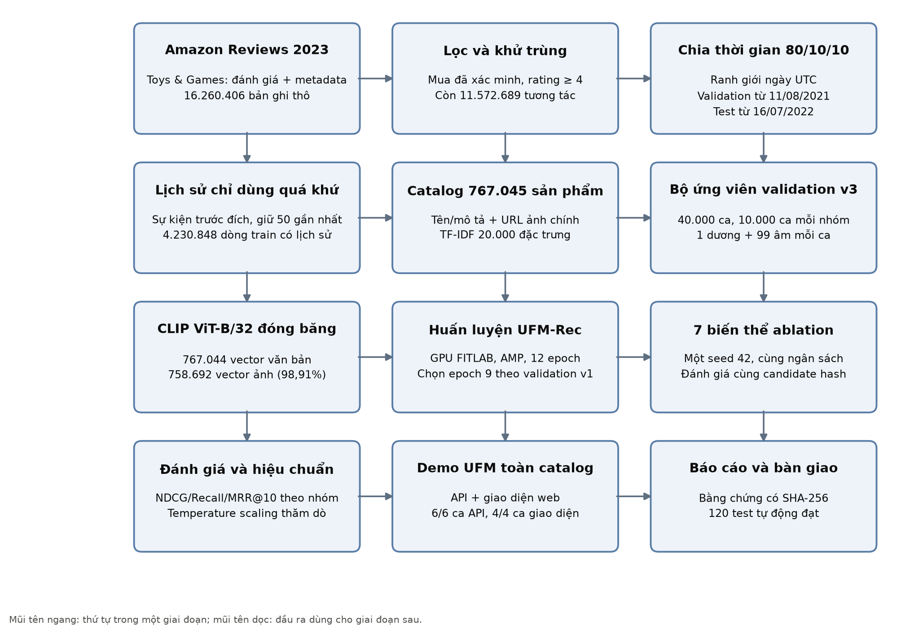

1. **Chuẩn bị dữ liệu** (`src/prepare_full_temporal.py`, `src/build_product_text.py`, `src/build_tfidf.py`, `src/prepare_ufm_catalog.py`): lọc, chia theo thời gian, dựng lịch sử, catalog nội dung và TF-IDF.
2. **Đặc trưng và mẫu đánh giá** (`src/extract_foundation_features.py`, `src/build_recommender_samples.py`): trích xuất CLIP và dựng bộ ứng viên cố định có mã băm.
3. **Huấn luyện và đánh giá** (`src/train_ufm_recommender.py`, `src/run_ufm_ablation_suite.py`, `src/reevaluate_ufm_checkpoints.py`): huấn luyện, chọn checkpoint, đánh giá lại trên bộ ứng viên mới, hiệu chuẩn.
4. **Ứng dụng** (`src/recommend_catalog.py`, `src/demo_recommender.py`, `demo/index.html`): suy luận trên toàn catalog và giao diện web.

---

### CHƯƠNG 4: MÔ HÌNH UFM-REC VÀ CÀI ĐẶT

#### 4.1. Tổng quan kiến trúc

UFM-Rec cho điểm từng cặp (người dùng $u$, ứng viên $j$) bằng hai nhánh song song rồi hợp nhất chúng. Toàn bộ kiến trúc được cài đặt trong `src/ufm_model.py` bằng PyTorch (Paszke và cộng sự, 2019). Luồng dữ liệu gồm năm bước:

1. Văn bản và ảnh của các sản phẩm trong lịch sử và của ứng viên đi qua bảng đặc trưng CLIP đã đóng băng, rồi qua adapter và chuẩn hóa L2.
2. Hồ sơ ngữ nghĩa của người dùng là trung bình các vector ngữ nghĩa khả dụng trong lịch sử; nhánh này không đi qua Transformer.
3. ID của các sản phẩm đã biết trong lịch sử, cộng embedding vị trí, đi qua Transformer nhân quả; trạng thái ở vị trí quan sát cuối cùng là biểu diễn hành vi của người dùng.
4. Mỗi nhánh tạo một vector cặp phụ thuộc ứng viên, kèm một đại lượng bất định dương.
5. Hai vector được hợp nhất theo trọng số độ tin cậy, cộng thêm thành phần căn chỉnh chéo, rồi qua đầu ra để thành điểm xếp hạng. Khi cả hai nhánh đều không có tín hiệu, mô hình dùng popularity của tập train.

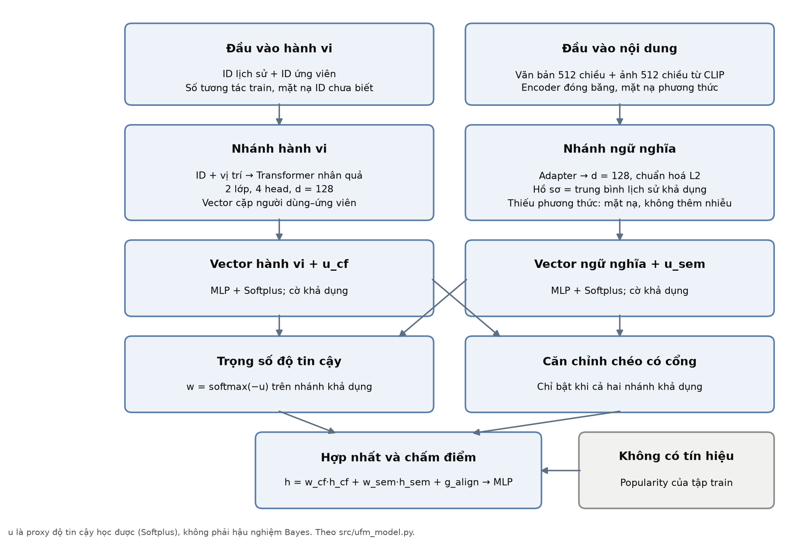

#### 4.2. Nhánh ngữ nghĩa

Gọi $\mathbf{e}_i^{\text{txt}}, \mathbf{e}_i^{\text{img}} \in \mathbb{R}^{512}$ là hai vector CLIP của sản phẩm $i$ và $m_i = (m_i^{\text{txt}}, m_i^{\text{img}})$ là mặt nạ khả dụng. Phương thức thiếu được gán vector 0 trước khi vào adapter, và chính mặt nạ cũng là một phần đầu vào để mô hình biết phương thức nào vắng mặt:

$$\mathbf{v}_i = \operatorname{LayerNorm}\Big(W_2\,\operatorname{GELU}\big(W_1\,[\,\mathbf{e}_i^{\text{txt}} \odot m_i^{\text{txt}},\; \mathbf{e}_i^{\text{img}} \odot m_i^{\text{img}},\; m_i\,]\big)\Big) \in \mathbb{R}^{128} \qquad (4.1)$$

Vector $\mathbf{v}_i$ sau đó được chuẩn hóa L2. Hồ sơ ngữ nghĩa của người dùng là trung bình các vector khả dụng trong lịch sử $S_u$, chuẩn hóa lại:

$$\mathbf{z}_u^{\text{sem}} = \operatorname{normalize}\Big(\frac{1}{|S_u^{+}|}\sum_{i \in S_u^{+}} \mathbf{v}_i\Big) \qquad (4.2)$$

trong đó $S_u^{+}$ là các sản phẩm trong lịch sử có ít nhất một phương thức. Vector cặp của nhánh ngữ nghĩa được tạo bằng một MLP trên phép ghép hồ sơ, ứng viên, tích từng phần tử và cờ phương thức của ứng viên:

$$\mathbf{h}_{uj}^{\text{sem}} = \operatorname{MLP}_{\text{sem}}\big([\,\mathbf{z}_u^{\text{sem}},\; \mathbf{v}_j,\; \mathbf{z}_u^{\text{sem}} \odot \mathbf{v}_j,\; m_j\,]\big) \qquad (4.3)$$

Nhánh ngữ nghĩa **khả dụng** khi lịch sử có ít nhất một sản phẩm có nội dung và ứng viên có ít nhất một phương thức. Vì gần như mọi sản phẩm đều có văn bản, nhánh này khả dụng cho cả sản phẩm zero-shot.

#### 4.3. Nhánh hành vi

Một ID sản phẩm được coi là **đã biết** khi nó có ít nhất một tương tác trong train. ID chưa biết được ánh xạ về hàng đệm (chỉ số 0) **trước khi** tra bảng embedding, nên trọng số và gradient của chúng không thể ảnh hưởng tới dự đoán. Lịch sử đi qua embedding ID cộng embedding vị trí học được, rồi qua Transformer nhân quả 2 lớp, 4 đầu chú ý, kích thước 128, dropout 0,1; vị trí của sản phẩm chưa biết vẫn được giữ trong chuỗi, chỉ phần đệm bị che. Biểu diễn hành vi $\mathbf{z}_u^{\text{cf}}$ là trạng thái ở vị trí quan sát cuối cùng.

Vector cặp của nhánh hành vi ghép biểu diễn người dùng, embedding của ứng viên, tích từng phần tử, cùng hai đặc trưng vô hướng: độ dài lịch sử và số tương tác train của ứng viên (cả hai lấy $\log(1+x)$):

$$\mathbf{h}_{uj}^{\text{cf}} = \operatorname{MLP}_{\text{cf}}\big([\,\mathbf{z}_u^{\text{cf}},\; \mathbf{q}_j,\; \mathbf{z}_u^{\text{cf}} \odot \mathbf{q}_j,\; \log(1+|S_u|),\; \log(1+c_{\text{train}}(j))\,]\big) \qquad (4.4)$$

Nhánh hành vi khả dụng khi người dùng có ít nhất một ID đã biết trong lịch sử và ứng viên có ID đã biết. Vì vậy với ứng viên zero-shot, nhánh hành vi luôn tắt. Trong lúc huấn luyện, mỗi ID đã biết bị bỏ ngẫu nhiên với xác suất 0,5 (**ID dropout**), buộc mô hình học cách dựa vào nhánh ngữ nghĩa khi thiếu tín hiệu hành vi.

#### 4.4. Proxy độ tin cậy và trọng số hợp nhất

Mỗi nhánh có một đầu dự đoán độ bất định, dùng hàm Softplus để bảo đảm giá trị dương:

$$u_{uj}^{\text{cf}} = \operatorname{Softplus}\big(\operatorname{MLP}_{u,\text{cf}}(\mathbf{h}_{uj}^{\text{cf}})\big), \qquad u_{uj}^{\text{sem}} = \operatorname{Softplus}\big(\operatorname{MLP}_{u,\text{sem}}(\mathbf{h}_{uj}^{\text{sem}})\big) \qquad (4.5)$$

Gọi $A_{uj} \subseteq \{\text{cf}, \text{sem}\}$ là tập nhánh khả dụng. Trọng số hợp nhất là softmax của độ bất định âm, chỉ tính trên các nhánh khả dụng:

$$w_{uj}^{k} = \frac{\mathbb{I}(k \in A_{uj})\,\exp(-u_{uj}^{k})}{\sum_{l \in A_{uj}} \exp(-u_{uj}^{l})}, \qquad A_{uj} \neq \emptyset \qquad (4.6)$$

Nhánh nào bất định hơn thì nhận trọng số nhỏ hơn. Nếu chỉ một nhánh khả dụng, nhánh đó nhận toàn bộ trọng số: với ứng viên zero-shot, $w^{\text{cf}} = 0$ và $w^{\text{sem}} = 1$. Phép tính được cài đặt ổn định số học bằng softmax có che (giá trị $-\infty$ cho nhánh không khả dụng) và có kiểm thử riêng.

#### 4.5. Căn chỉnh chéo có cổng và đầu ra

Khi cả hai nhánh cùng khả dụng, một thành phần căn chỉnh được cộng thêm để mô hình học tương tác giữa hai nguồn:

$$\mathbf{g}_{uj} = \sigma\big(W_g[\mathbf{h}^{\text{cf}}_{uj}, \mathbf{h}^{\text{sem}}_{uj}]\big) \odot W_a[\mathbf{h}^{\text{cf}}_{uj}, \mathbf{h}^{\text{sem}}_{uj}] \cdot \mathbb{I}(\text{cf} \in A_{uj} \wedge \text{sem} \in A_{uj}) \qquad (4.7)$$

Vector hợp nhất và điểm xếp hạng là:

$$\mathbf{h}_{uj} = w_{uj}^{\text{cf}}\,\mathbf{h}_{uj}^{\text{cf}} + w_{uj}^{\text{sem}}\,\mathbf{h}_{uj}^{\text{sem}} + \mathbf{g}_{uj}, \qquad s_{uj} = \operatorname{MLP}_{\text{out}}(\mathbf{h}_{uj}) \qquad (4.8)$$

Nếu một ứng viên không có nhánh nào khả dụng trong khi các ứng viên khác có, điểm của nó được đặt thấp hơn điểm nhỏ nhất của nhóm có tín hiệu. Nếu không ứng viên nào có tín hiệu (người dùng không có lịch sử), điểm là $\log(1 + c_{\text{train}}(j))$, tức xếp theo popularity của tập train. Mô hình không bao giờ dùng số tương tác của validation hay test.

#### 4.6. Hàm mất mát

Mỗi mẫu huấn luyện gồm sản phẩm đích (dương) ở cột 0 và $N = 8$ mẫu âm. Hàm mất mát gồm bốn thành phần:

$$\mathcal{L} = \mathcal{L}_{\text{rank}} + \lambda_{\text{align}}\,\mathcal{L}_{\text{align}} + \lambda_{\text{unc}}\,\mathcal{L}_{\text{unc}} + \lambda_{\text{cal}}\,\mathcal{L}_{\text{cal}} \qquad (4.9)$$

với $\lambda_{\text{align}} = 0{,}01$, $\lambda_{\text{unc}} = 0{,}01$, $\lambda_{\text{cal}} = 0{,}1$. Với $p$ là sản phẩm đích và $\mathcal{N}$ là tập mẫu âm hợp lệ, các thành phần được định nghĩa như sau:

$$\mathcal{L}_{\text{rank}} = \frac{1}{|\mathcal{N}|}\sum_{j \in \mathcal{N}} \operatorname{Softplus}\big(s_{uj} - s_{up}\big) \qquad (4.10)$$

$$\mathcal{L}_{\text{align}} = 1 - \cos\big(\mathbf{h}^{\text{cf}}_{uj}, \mathbf{h}^{\text{sem}}_{uj}\big) \quad \text{(trung bình trên các cặp có đủ hai nhánh)} \qquad (4.11)$$

$$\mathcal{L}_{\text{unc}} = \operatorname{MSE}\Big(u^{k}_{uj},\; \big(\sigma(s^{k}_{uj})_{\text{dừng gradient}} - y_{uj}\big)^2\Big), \quad k \in A_{uj} \qquad (4.12)$$

$$\mathcal{L}_{\text{cal}} = \operatorname{BCE}\big(s_{uj}, y_{uj}\big) \qquad (4.13)$$

Thành phần xếp hạng là thành phần chính, có dạng BPR (mục 2.2): mẫu âm chỉ bị phạt nhiều khi điểm của nó vượt điểm của mẫu dương. Thành phần bất định buộc $u^k$ khớp với sai số bình phương của chính nhánh $k$; điểm của nhánh được ngắt gradient, nên mô hình không thể tự tăng $u$ để "né" mất mát. Thành phần hiệu chuẩn là entropy chéo nhị phân trên các ứng viên đã lấy mẫu, không phải xác suất mua hàng thực tế.

#### 4.7. Lấy mẫu âm khi huấn luyện

Với mỗi mẫu dương, 8 mẫu âm được lấy **ngẫu nhiên đều** trong 584.846 sản phẩm có tương tác train. Mọi sản phẩm dương của người dùng trong tập train (kể cả các tương tác đầu tiên), các sản phẩm trong lịch sử của mẫu và chính sản phẩm đích đều bị loại khỏi tập mẫu âm, để tránh dạy mô hình rằng một sản phẩm người dùng thực sự thích là "sai". Mẫu âm không bao giờ lấy từ validation hay test. Cách lấy mẫu khi huấn luyện khác với cách dựng bộ ứng viên đánh giá (mục 5.1), nơi mẫu âm được lấy theo độ phổ biến trong cùng nhóm với sản phẩm đích.

#### 4.8. Siêu tham số và môi trường huấn luyện

*Bảng: Siêu tham số huấn luyện mô hình UFM-Rec*

| Siêu tham số | Giá trị | Ghi chú |
| --- | --- | --- |
| Kích thước vector ẩn $d$ | 128 | Chung cho cả hai nhánh |
| Số lớp / số đầu chú ý Transformer | 2 / 4 | Chú ý nhân quả |
| Độ dài lịch sử | 20 | 20 tương tác dương gần nhất |
| Dropout / ID dropout | 0,1 / 0,5 | ID dropout chỉ áp dụng khi huấn luyện |
| Số mẫu âm mỗi mẫu dương | 8 | Lấy đều, chỉ từ train |
| Kích thước lô | 256 | |
| Bộ tối ưu | AdamW (Loshchilov và Hutter, 2019), tốc độ học $3 \times 10^{-4}$, weight decay $10^{-4}$ | Không dùng lịch giảm tốc độ học |
| Cắt gradient | chuẩn 1,0 | |
| Độ chính xác hỗn hợp (AMP; Micikevicius và cộng sự, 2018) | Bật (float16) | GradScaler tự bỏ bước bị tràn số |
| Số epoch tối đa / dừng sớm | 20 / sau 3 epoch không cải thiện | |
| Tiêu chí chọn checkpoint | Cold macro NDCG@10 trên validation v1 | |
| Lưu checkpoint | Mỗi 1.000 bước | Gồm trạng thái bộ tối ưu và bộ sinh số ngẫu nhiên |
| Seed | 42 | |

Nguồn: tham số mặc định của `src/train_ufm_recommender.py` và cấu hình lưu kèm lượt chạy. Kế hoạch đa seed (mục 7.3) dùng đúng các giá trị này.

*Bảng: Môi trường phần cứng và phần mềm*

| Thành phần | Huấn luyện (FITLAB) | Kiểm thử và demo (máy Windows) |
| --- | --- | --- |
| GPU | NVIDIA Quadro RTX 6000, 24.576 MiB | Không dùng GPU |
| Python | 3.12.3 | 3.14 |
| PyTorch | 2.12.1+cu130 | 2.14.1 (CPU) |
| Thư viện khác | Transformers 4.57.6, scikit-learn 1.6.1, NumPy 2.2.6 | python-docx, Pandoc, LibreOffice cho tài liệu |
| CPU / RAM | Máy chủ dùng chung | 8 luồng, 16 GB RAM |

Thông tin GPU và phiên bản lấy từ các bản ghi kiểm tra trên FITLAB và máy local trong `reports/`.

#### 4.9. Quá trình huấn luyện

Mô hình đầy đủ được huấn luyện trên FITLAB trong 12 epoch, tổng cộng 198.232 bước cập nhật, mất khoảng 14.866 giây (4,13 giờ) cho tiến trình cuối. Mỗi epoch xử lý khoảng 4,23 triệu mẫu (16.520 bước). Mỗi epoch có 6–8 lô (1.536–2.048 mẫu) bị bỏ qua, do gradient tràn số float16 khi dùng AMP hoặc do lô không có mẫu âm hợp lệ; GradScaler giảm hệ số tỉ lệ và các lô này không cập nhật trọng số.

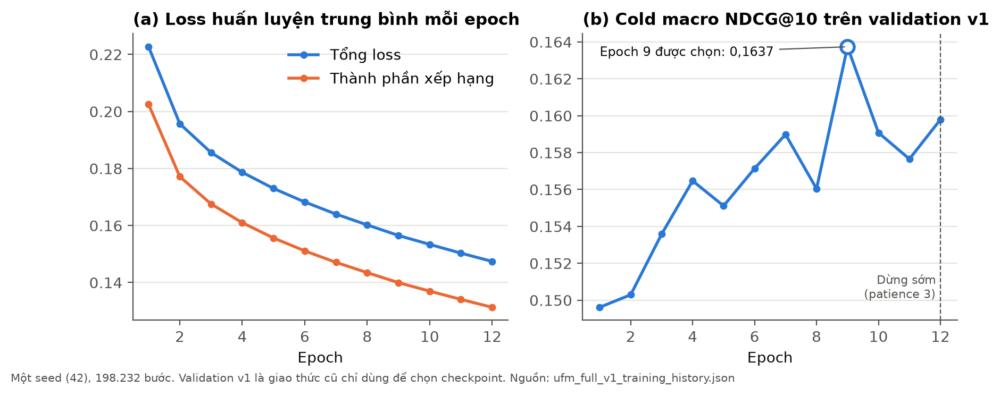

*Bảng: Diễn biến huấn luyện tại một số epoch*

| Epoch | Bước | Tổng loss | Thành phần xếp hạng | Cold macro NDCG@10 (validation v1) |
| ---: | ---: | ---: | ---: | ---: |
| 1 | 16.521 | 0,2227 | 0,2025 | 0,149615 |
| 3 | 49.560 | 0,1856 | 0,1677 | 0,153583 |
| 6 | 99.117 | 0,1683 | 0,1510 | 0,157141 |
| **9** | **148.674** | **0,1565** | **0,1400** | **0,163738** |
| 12 | 198.232 | 0,1474 | 0,1313 | 0,159792 |

Loss huấn luyện giảm đều qua cả 12 epoch, trong khi chỉ số dùng để chọn checkpoint đạt cao nhất ở epoch 9 rồi dao động. Sau ba epoch liên tiếp không vượt epoch 9, huấn luyện dừng theo quy tắc dừng sớm, và checkpoint epoch 9 được giữ làm mô hình chính. Validation v1 là giao thức cũ (mục 5.1); con số ở bảng này chỉ phục vụ việc chọn checkpoint và không so sánh với kết quả v3 ở Chương 5. Nguồn: [`ufm_full_v1_training_history.json`](../reports/final_20261103/ufm_full_v1_training_history.json).

#### 4.10. Các biến thể ablation và hai can thiệp theo số tương tác

Để định lượng đóng góp của từng thành phần, mô hình được cài đặt dưới dạng một lớp duy nhất với tham số `variant`. Mỗi biến thể chỉ thay một cơ chế; các biến thể ablation được huấn luyện từ đầu với cùng dữ liệu, siêu tham số và quy tắc chọn checkpoint.

*Bảng: Các biến thể của mô hình UFM-Rec*

| Biến thể | Thay đổi so với bản đầy đủ | Câu hỏi kiểm chứng | Trạng thái |
| ------------ | --------------- | --------------- | --------- |
| full | — | Mốc so sánh | Đã huấn luyện |
| semantic_only | Tắt nhánh hành vi | Nhánh hành vi có giúp không? | Đã huấn luyện |
| collaborative_only | Tắt nhánh ngữ nghĩa | Nhánh ngữ nghĩa có cần không? | Đã huấn luyện |
| text_only | Bỏ vector ảnh | Ảnh đóng góp bao nhiêu? | Đã huấn luyện |
| image_only | Bỏ vector văn bản | Văn bản đóng góp bao nhiêu? | Đã huấn luyện |
| fixed_fusion | Trọng số cố định 0,5/0,5 | Trọng số học được có hơn trọng số tĩnh? | Đã huấn luyện |
| no_uncertainty | Cổng softmax học trực tiếp, không dùng proxy bất định | Proxy độ tin cậy có cần không? | Đã huấn luyện |
| no_cross_align | Bỏ thành phần căn chỉnh chéo | Căn chỉnh chéo có cần không? | Đã huấn luyện |
| count_aware_fusion | Cộng $e^{-c/5}$ vào $u^{\text{cf}}$ | Phạt nhánh hành vi ở sản phẩm ít tương tác có giúp? | Đã cài đặt, chưa huấn luyện |
| adaptive_dropout | ID dropout $p = 0{,}5\,e^{-c/10}$ | Bỏ ID theo tần suất có giúp? | Đã cài đặt, chưa huấn luyện |

Hai biến thể cuối là hai can thiệp do nhóm đề xuất sau khi phân tích kết quả theo số tương tác (mục 5.6). `count_aware_fusion` tăng độ bất định của nhánh hành vi cho ứng viên ít tương tác:

$$u_{uj}^{\text{cf}} \leftarrow u_{uj}^{\text{cf}} + \exp\big(-c_{\text{train}}(j)/5\big) \qquad (4.14)$$

`adaptive_dropout` thay xác suất bỏ ID cố định bằng xác suất giảm dần theo số tương tác, không cộng phạt vào độ bất định:

$$p_{\text{drop}}(i) = 0{,}5 \cdot \exp\big(-c_{\text{train}}(i)/10\big) \qquad (4.15)$$

Hai can thiệp được tách thành hai biến thể riêng để có thể quy tác dụng cho đúng một cơ chế. Cả hai đã có kiểm thử bất biến (ví dụ: với cùng trọng số, `count_aware_fusion` cho độ bất định nhánh hành vi cao hơn ở ứng viên lạnh), nhưng chưa có kết quả chất lượng sau huấn luyện.

#### 4.11. Vận hành huấn luyện dài hạn trên FITLAB

FITLAB là máy chủ dùng chung của khoa: GPU có thể đang được tiến trình khác dùng, phiên làm việc có thể bị khởi động lại. Nhóm thiết kế quy trình huấn luyện để chịu được các tình huống này:

- **Hàng đợi và giám sát.** Các lượt chạy được xếp hàng, chỉ khởi động khi đầu vào đã đủ và GPU rảnh; một tiến trình giám sát (watchdog) dùng khóa tệp để tránh hai lượt chạy cùng ghi một thư mục (`ops/watch_campaign.py`, `ops/resume_campaign.py`).
- **Checkpoint và resume.** Checkpoint mới nhất được lưu mỗi 1.000 bước, gồm trọng số, trạng thái bộ tối ưu, GradScaler, bộ sinh số ngẫu nhiên và vị trí trong epoch, nên lượt chạy có thể tiếp tục đúng chỗ dừng. Checkpoint tốt nhất được lưu riêng. Nhóm đã resume thành công sau sự cố tràn số AMP và sau khi phiên làm việc khởi động lại.
- **Sự cố hạ tầng.** Ngày 02/10/2026 thư mục làm việc trên FITLAB-02 báo lỗi vào/ra (EIO) và tiến trình demo thoát với "Bus error"; ngày 24/10 workspace được dựng lại từ bản lưu trữ cũ. Nhờ các gói sao lưu có manifest, nhóm khôi phục và đối chiếu SHA-256 đủ 796 tệp (15.010.960.088 byte) gồm checkpoint, đặc trưng CLIP và dữ liệu đã xử lý vào máy Windows ngày 28/10.
- **Không đánh giá test trong lúc huấn luyện.** Trình huấn luyện chỉ đánh giá trên validation; mọi lần mở test được ghi vào sổ theo dõi (`reports/test_evaluation_ledger.json`).

#### 4.12. Kiểm thử tự động

Bộ kiểm thử dùng pytest, gồm 123 ca trong 25 tệp. Trên máy Windows ngày 03/11/2026: **120 đạt, 3 bỏ qua** (ba ca chỉ chạy trên Linux), không có cảnh báo. CI trên GitHub Actions chạy cùng bộ kiểm thử trên Windows và Ubuntu cho mỗi lần đẩy mã.

*Bảng: Bộ kiểm thử tự động theo nhóm chức năng*

| Nhóm chức năng | Tệp kiểm thử chính | Số ca | Nội dung kiểm tra |
| --------- | ------------------ | -----: | ------------------ |
| Lõi mô hình | test_ufm_core.py | 16 | Mặt nạ nhân quả, trọng số độ tin cậy ổn định, ID lạ không nhận gradient, các biến thể, hiệu chuẩn tính tay |
| Huấn luyện | test_ufm_training.py, test_ufm_training_queue.py, test_ufm_ablation_suite.py | 12 | Resume đúng vị trí, lấy mẫu âm, hàng đợi, bộ ablation |
| Cold-start | test_cold_start_bug_condition.py | 11 | Hồi quy cấu trúc cho ứng viên zero-shot và cực lạnh |
| Mẫu đánh giá | test_sample_builder.py, test_candidate_audit.py, test_calibration_candidates.py | 15 | 1 dương + 99 âm duy nhất, không trùng lịch sử, báo lỗi khi thiếu ứng viên |
| Hiệu chuẩn | test_calibration_validation.py | 2 | Chia theo thời gian, nhiệt độ tính tay |
| Đối chứng | test_bpr_mf.py, test_sasrec.py, test_comparison_models.py, test_content_baseline_cli.py | 9 | BPR-MF, SASRec, các mô hình so sánh, TF-IDF |
| Demo | test_recommend_demo.py | 8 | Catalog mẫu, chặn URL ảnh lạ, từ chối origin lạ, che ID lạ |
| Vận hành và sao lưu | test_artifact_backup.py, test_campaign_*.py, test_foundation_queue.py, test_fitlab_layout.py, test_trained_source.py | 19 | Sao lưu từ chối gói hỏng, watchdog, nguồn huấn luyện đúng mã băm |
| Kế hoạch và sổ test | test_followup_plan.py, test_locked_followup_summary.py, test_evaluation_ledger.py | 7 | Kế hoạch 15 lượt khóa, tổng hợp từ chối dữ liệu lẫn test |
| Notebook và tài liệu | test_colab_notebook_resume.py, test_school_report.py | 24 | Khôi phục từ Drive có kiểm SHA, dựng báo cáo |

---

### CHƯƠNG 5: THỰC NGHIỆM VÀ KẾT QUẢ

#### 5.1. Giao thức đánh giá

Mỗi ca đánh giá gồm một người dùng, lịch sử của họ tại thời điểm tương tác và một tập 100 ứng viên: sản phẩm đích (sản phẩm người dùng thực sự mua) ở cột 0 và 99 sản phẩm âm khác nhau. Mỗi bộ đánh giá có 40.000 ca, lấy cân bằng 10.000 ca cho mỗi nhóm theo số tương tác train của sản phẩm đích. Một người dùng có thể xuất hiện ở nhiều ca, nên các ca không phải quan sát độc lập. Khi điểm bằng nhau, thứ tự được phá bằng nhiễu cố định theo seed để không ứng viên nào được ưu tiên vì vị trí.

Trong quá trình làm đồ án, giao thức đánh giá được sửa hai lần khi nhóm phát hiện các vấn đề trong cách lấy mẫu âm. Ba phiên bản được giữ tách biệt; **mọi bảng so sánh chỉ dùng một bộ ứng viên**, nhận diện bằng mã băm SHA-256 của tệp mẫu.

*Bảng: Ba phiên bản giao thức đánh giá*

| Phiên bản | Mã băm bộ validation | Cách lấy 99 mẫu âm | Vai trò trong báo cáo |
| ------ | --------- | ------------------ | ------------ |
| v1 | `8efa1165…` | Quy tắc cũ, trước khi thống nhất xử lý sản phẩm chưa xuất hiện; audit ghi nhận 3 mẫu âm trùng sản phẩm dương của train | Chọn checkpoint; kết quả lịch sử (mục 5.9) |
| v2 | `c71906e6…` | Cùng nhóm với sản phẩm đích; trọng số theo popularity đến cuối tập; loại đích và lịch sử đã ghi | Kết quả lịch sử, đã đánh giá cả test (mục 5.9) |
| **v3** | `9387e66e…` | Như v2, đồng thời loại **mọi** sản phẩm dương có thời điểm trước đích, kể cả ngoài cửa sổ lịch sử | **Kết quả chính** của Chương 5 |

Validation v3 có hai giới hạn cần nêu rõ. Thứ nhất, checkpoint đã được chọn trên validation v1, dùng cùng quần thể người dùng và thời gian, nên v3 **không phải tập kiểm tra độc lập**: các kết quả v3 mang tính thăm dò. Thứ hai, mẫu âm được lấy theo nhóm của sản phẩm đích và theo thống kê đến cuối tập, tức có tính hồi cứu; điểm trên 100 ứng viên không tương đương xếp hạng toàn catalog hay đánh giá trực tuyến (mục 2.7). Tập test v2 đã được mở trong lịch sử dự án và được ghi vào sổ theo dõi; nhóm không dùng nó để chọn mô hình.

#### 5.2. Các mô hình được so sánh

Mười mô hình và biến thể được đánh giá trên **cùng** bộ ứng viên v3:

- **Popularity:** xếp ứng viên theo số tương tác train. Vì mẫu âm cùng nhóm với đích, các ứng viên zero-shot đều có điểm 0 và được phá hòa ngẫu nhiên.
- **TF-IDF:** hồ sơ người dùng là tổng vector TF-IDF của tối đa 10 sản phẩm gần nhất trong lịch sử; ứng viên được xếp theo tích vô hướng giữa vector đã chuẩn hóa của nó và hồ sơ, cho cùng thứ tự với cosine.
- **UFM full** và bảy biến thể ablation ở mục 4.10, đều từ seed 42 với cùng ngân sách huấn luyện.

Với người dùng không có lịch sử, mọi mô hình đều rơi về popularity, nên chênh lệch giữa các mô hình chỉ nằm ở nhóm ca có lịch sử. TF-IDF dùng 10 sản phẩm lịch sử trong khi UFM dùng 20 và hai mô hình có mục tiêu khác nhau, nên so sánh UFM với TF-IDF là **so sánh hệ thống**, không quy chênh lệch cho riêng một thành phần.

#### 5.3. Kết quả tổng thể trên validation v3

*Bảng: Kết quả chính trên validation v3 (40.000 ca, 100 ứng viên/ca, seed 42)*

| Mô hình | Cold macro NDCG@10 | Overall NDCG@10 | Recall@10 | MRR@10 |
| --- | ---: | ---: | ---: | ---: |
| TF-IDF | **0,195682** | **0,181505** | **0,281275** | **0,151050** |
| Semantic-only | 0,190036 | 0,166404 | 0,268500 | 0,135315 |
| No cross-align | 0,183393 | 0,164897 | 0,262100 | 0,135189 |
| No uncertainty | 0,182253 | 0,163858 | 0,262900 | 0,133661 |
| UFM full | 0,182056 | 0,164136 | 0,262300 | 0,134202 |
| Text-only | 0,181982 | 0,158219 | 0,255275 | 0,128593 |
| Fixed fusion | 0,181305 | 0,163285 | 0,262475 | 0,133013 |
| Image-only | 0,149632 | 0,135772 | 0,231375 | 0,106708 |
| Collaborative-only | 0,070003 | 0,069681 | 0,142450 | 0,047936 |
| Popularity | 0,042527 | 0,040904 | 0,090900 | 0,026106 |

Nguồn: [kết quả v3](../reports/continuation_20261028/validation_v3_results.json) và [bảng bằng chứng có mã băm](../reports/nontraining_20261029/evidence.json).

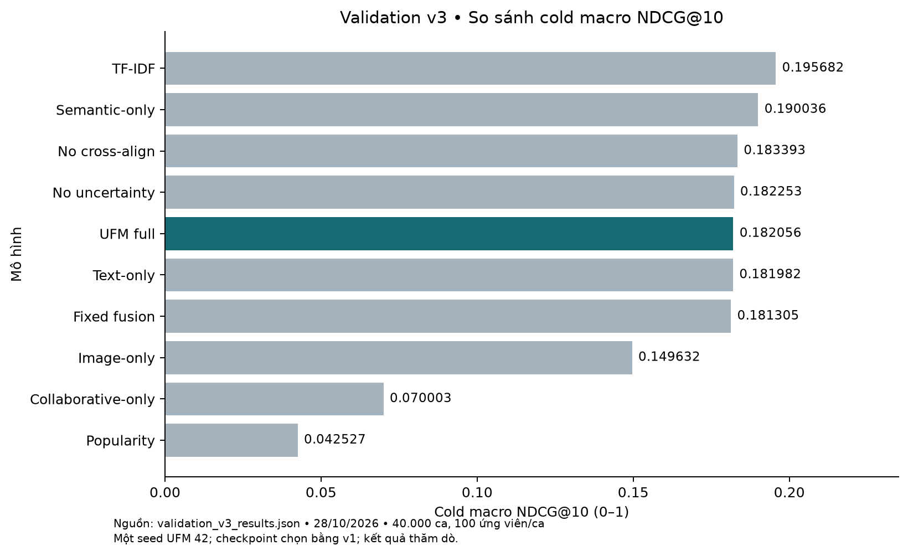

Kết quả chính có ba điểm đáng chú ý. Thứ nhất, **TF-IDF dẫn đầu mọi chỉ số tổng thể**; UFM full thấp hơn TF-IDF 0,013626 và thấp hơn semantic-only 0,007980 ở chỉ số chính. Thứ hai, mọi biến thể dùng văn bản CLIP đều nằm trong khoảng 0,181–0,190, cách nhau rất ít; chênh lệch giữa UFM full và fixed fusion chỉ 0,000751, quá nhỏ để kết luận với một seed. Thứ ba, các biến thể thiếu văn bản tụt mạnh: image-only còn 0,149632 và collaborative-only chỉ 0,070003, cho thấy văn bản là nguồn tín hiệu quan trọng nhất cho sản phẩm lạnh trong dữ liệu này.

#### 5.4. Kết quả theo nhóm sản phẩm

*Bảng: NDCG@10 theo nhóm sản phẩm trên validation v3*

| Mô hình | Zero-shot | Extreme cold | Cold | Warm |
| --- | ---: | ---: | ---: | ---: |
| TF-IDF | **0,176026** | 0,213208 | 0,197812 | **0,138976** |
| Semantic-only | 0,159080 | **0,215668** | 0,195360 | 0,095509 |
| No cross-align | 0,158768 | 0,192795 | 0,198617 | 0,109409 |
| No uncertainty | 0,155025 | 0,191733 | **0,200001** | 0,108672 |
| UFM full | 0,156655 | 0,191567 | 0,197946 | 0,110375 |
| Text-only | 0,155580 | 0,198061 | 0,192305 | 0,086929 |
| Fixed fusion | 0,156044 | 0,190398 | 0,197474 | 0,109226 |
| Image-only | 0,128655 | 0,157320 | 0,162920 | 0,094194 |
| Collaborative-only | 0,044967 | 0,068143 | 0,096899 | 0,068713 |
| Popularity | 0,044967 | 0,038665 | 0,043948 | 0,036034 |

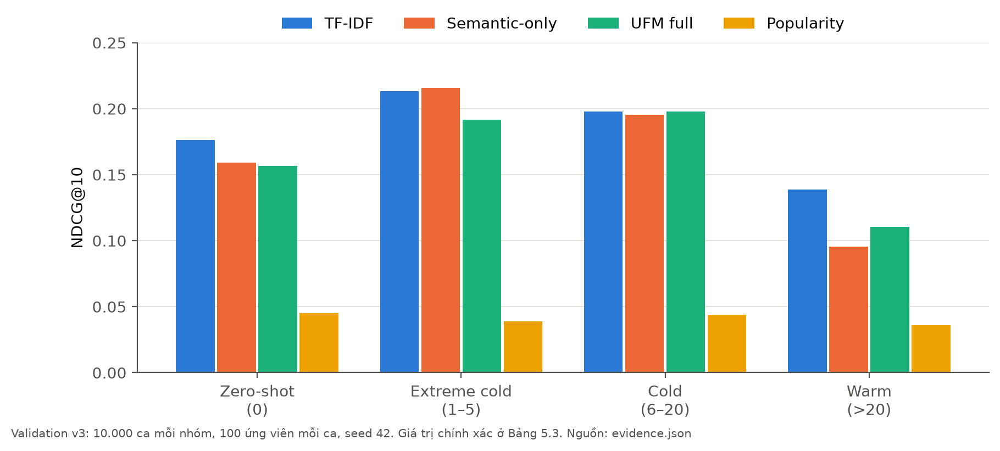

*Bảng: Recall@10 theo nhóm sản phẩm trên validation v3*

| Mô hình | Zero-shot | Extreme cold | Cold | Warm |
| --- | ---: | ---: | ---: | ---: |
| TF-IDF | 0,2664 | 0,3222 | 0,3072 | 0,2293 |
| Semantic-only | 0,2540 | 0,3400 | 0,3095 | 0,1705 |
| UFM full | 0,2519 | 0,2972 | 0,3084 | 0,1917 |
| Fixed fusion | 0,2509 | 0,2993 | 0,3089 | 0,1908 |
| Image-only | 0,2212 | 0,2634 | 0,2697 | 0,1712 |
| Collaborative-only | 0,0981 | 0,1380 | 0,1918 | 0,1419 |
| Popularity | 0,0981 | 0,0851 | 0,0990 | 0,0814 |

Bức tranh theo nhóm rõ hơn kết quả tổng thể:

- **Zero-shot:** nhánh hành vi luôn tắt, nên UFM full về bản chất là mô hình ngữ nghĩa (0,156655 so với 0,159080 của semantic-only). TF-IDF tốt hơn cả hai (0,176026).
- **Extreme cold (1–5 tương tác):** semantic-only cao nhất (0,215668), nhỉnh hơn TF-IDF. UFM full chỉ đạt 0,191567: thêm nhánh hành vi làm **giảm** 0,024101 so với chỉ dùng ngữ nghĩa.
- **Cold (6–20):** các biến thể dung hợp bắt kịp TF-IDF; UFM full nhỉnh hơn TF-IDF rất ít (0,197946 so với 0,197812) và no uncertainty đạt cao nhất (0,200001).
- **Warm (>20):** nhánh hành vi giúp UFM full hơn semantic-only 0,014865, nhưng vẫn thấp hơn TF-IDF (0,138976). Collaborative-only rất yếu ngay cả ở nhóm ấm (0,068713), vì trong v3 mẫu âm của ca ấm cũng là sản phẩm ấm, nên độ phổ biến không còn là lợi thế.

#### 5.5. Theo lịch sử người dùng và loại giao dịch

Trong 40.000 ca, 20.601 ca có lịch sử và 19.399 ca không có. Với ca không có lịch sử, mọi mô hình rơi về popularity nên có cùng NDCG@10 = 0,041908. Toàn bộ khác biệt giữa các mô hình vì vậy nằm trong 20.601 ca có lịch sử (Hình 5.3).

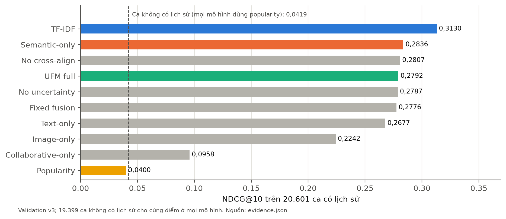

*Bảng: NDCG@10 theo việc người dùng có lịch sử hay không*

| Mô hình | Có lịch sử (20.601 ca) | Không có lịch sử (19.399 ca) | Mua mới (39.942 ca) | Mua lại (58 ca) |
| --- | ---: | ---: | ---: | ---: |
| TF-IDF | 0,312958 | 0,041908 | 0,180394 | 0,946734 |
| Semantic-only | 0,283637 | 0,041908 | 0,165365 | 0,882036 |
| UFM full | 0,279232 | 0,041908 | 0,163058 | 0,906072 |
| Fixed fusion | 0,277581 | 0,041908 | 0,162219 | 0,897788 |
| Popularity | 0,039958 | 0,041908 | 0,040858 | 0,072457 |

Gần như mọi ca là lượt mua sản phẩm mới đối với người dùng; chỉ 58 ca là mua lại một sản phẩm đã có trong lịch sử, nên chỉ số mua lại có phương sai lớn và không dùng để kết luận. Khoảng cách giữa TF-IDF và UFM full trên các ca có lịch sử là 0,033726, lớn gấp đôi khoảng cách trên toàn bộ dữ liệu.

#### 5.6. Phân tích theo số tương tác của sản phẩm đích

Để tìm nơi việc dung hợp gây hại, nhóm so sánh từng cặp dự đoán đã lưu của UFM full, semantic-only và fixed fusion trên cùng ca (so sánh ghép cặp), chia theo số tương tác train của sản phẩm đích.

*Bảng: Chênh lệch ghép cặp NDCG@10 theo số tương tác train của sản phẩm đích*

| Số tương tác | Số ca | UFM full | Semantic-only | Fixed fusion | Full − semantic | Full − fixed |
| --- | ---: | ---: | ---: | ---: | ---: | ---: |
| 0 | 10.000 | 0,156655 | 0,159080 | 0,156044 | −0,002424 | +0,000612 |
| 1–5 | 10.000 | 0,191567 | 0,215668 | 0,190398 | **−0,024101** | +0,001170 |
| 6–20 | 10.000 | 0,197946 | 0,195360 | 0,197474 | +0,002586 | +0,000472 |
| 21+ | 10.000 | 0,110375 | 0,095509 | 0,109226 | **+0,014865** | +0,001148 |

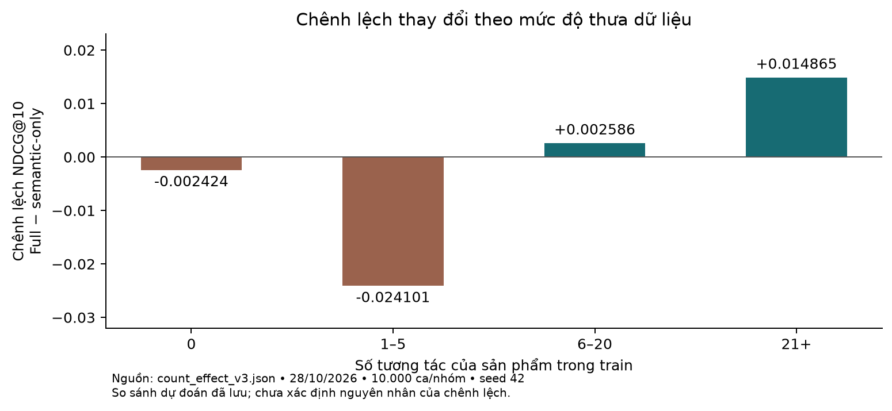

Khi chỉ xét các ca có lịch sử, tín hiệu còn rõ hơn:

*Bảng: Chênh lệch ghép cặp trên các ca có lịch sử*

| Số tương tác | Số ca có lịch sử | UFM full | Semantic-only | Full − semantic |
| --- | ---: | ---: | ---: | ---: |
| 0 | 5.129 | 0,262624 | 0,267350 | −0,004727 |
| 1–5 | 5.247 | 0,329435 | 0,375367 | **−0,045933** |
| 6–20 | 5.300 | 0,333689 | 0,328810 | +0,004879 |
| 21+ | 4.925 | 0,184442 | 0,154259 | **+0,030183** |

Kết quả cho thấy một mẫu hình nhất quán: thêm nhánh hành vi **có lợi khi sản phẩm đích có từ 6 tương tác trở lên** và lợi ích tăng theo số tương tác, nhưng **gây hại rõ ở nhóm 1–5 tương tác**. Nguồn: [`count_effect_v3.json`](../reports/continuation_20261028/count_effect_v3.json).

Một giải thích hợp lý là embedding ID của sản phẩm chỉ có 1–5 tương tác được học từ quá ít gradient, nên nhiễu; khi nhánh hành vi khả dụng, cổng vẫn trao cho nó một phần trọng số và làm nhiễu điểm của nhánh ngữ nghĩa. Tuy nhiên đây mới là **giả thuyết**: phân tích trên chỉ là chênh lệch quan sát trên một checkpoint một seed, chưa có phân bố trọng số cổng hay độ bất định theo nhóm, và chưa có thí nghiệm can thiệp được huấn luyện. Hai biến thể `count_aware_fusion` và `adaptive_dropout` (mục 4.10) được thiết kế chính để kiểm chứng giả thuyết này.

#### 5.7. Phân tích ablation

*Bảng: Chênh lệch của từng biến thể so với UFM full*

| Biến thể | Cold macro | So với full | Warm | So với full |
| --- | ---: | ---: | ---: | ---: |
| Semantic-only (bỏ nhánh hành vi) | 0,190036 | +0,007980 | 0,095509 | −0,014866 |
| No cross-align | 0,183393 | +0,001337 | 0,109409 | −0,000966 |
| No uncertainty | 0,182253 | +0,000197 | 0,108672 | −0,001703 |
| Text-only (bỏ ảnh) | 0,181982 | −0,000074 | 0,086929 | −0,023446 |
| Fixed fusion | 0,181305 | −0,000751 | 0,109226 | −0,001149 |
| Image-only (bỏ văn bản) | 0,149632 | −0,032424 | 0,094194 | −0,016181 |
| Collaborative-only (bỏ nhánh ngữ nghĩa) | 0,070003 | −0,112053 | 0,068713 | −0,041662 |

Có thể rút ra các nhận xét sau, với lưu ý mọi con số chỉ từ một seed:

1. **Văn bản là nguồn tín hiệu chính.** Bỏ văn bản làm cold macro giảm 0,032424; bỏ ảnh gần như không đổi cold macro.
2. **Ảnh có ích ở nhóm ấm.** Bỏ ảnh làm NDCG nhóm ấm giảm 0,023446, mức giảm lớn nhất trong các ablation trừ việc bỏ nhánh ngữ nghĩa. Ảnh dường như giúp phân biệt các sản phẩm phổ biến có tên gần giống nhau.
3. **Nhánh ngữ nghĩa không thể thiếu.** Collaborative-only thấp nhất ở mọi nhóm sau popularity.
4. **Proxy độ tin cậy và căn chỉnh chéo chưa cho thấy lợi ích đo được.** Bỏ từng thành phần làm cold macro tăng nhẹ (0,000197 và 0,001337), trong khi warm giảm nhẹ. Các chênh lệch này nhỏ hơn nhiều so với biến thiên thường gặp giữa các seed, nên không thể kết luận thành phần nào có ích hay có hại.
5. **Trọng số học được so với trọng số cố định.** UFM full nhỉnh hơn fixed fusion ở mọi nhóm trong so sánh ghép cặp (+0,000472 đến +0,001170), một tín hiệu nhất quán nhưng rất nhỏ.

#### 5.8. Hiệu chuẩn điểm số

Nhóm đánh giá hiệu chuẩn của xác suất top-1 trên tập 100 ứng viên (công thức 2.9). Validation v3 được chia theo thời gian: 20.000 ca sớm hơn để tìm nhiệt độ, 20.000 ca muộn hơn để kiểm tra; các ca cùng thời điểm được giữ cùng một phía. Nhiệt độ tối ưu là $T = 2{,}012405$, nghĩa là mô hình gốc tự tin quá mức và cần "làm mềm" phân bố điểm.

*Bảng: Hiệu chuẩn bằng temperature scaling trên phần kiểm tra của validation v3*

| Chỉ số trên 20.000 ca kiểm tra | Trước | Sau | Thay đổi |
| --- | ---: | ---: | ---: |
| ECE (15 khoảng) | 0,082061 | 0,037478 | −54,3% |
| NLL | 4,497667 | 4,258086 | −5,3% |
| Brier đa lớp | 0,969342 | 0,960605 | −0,9% |

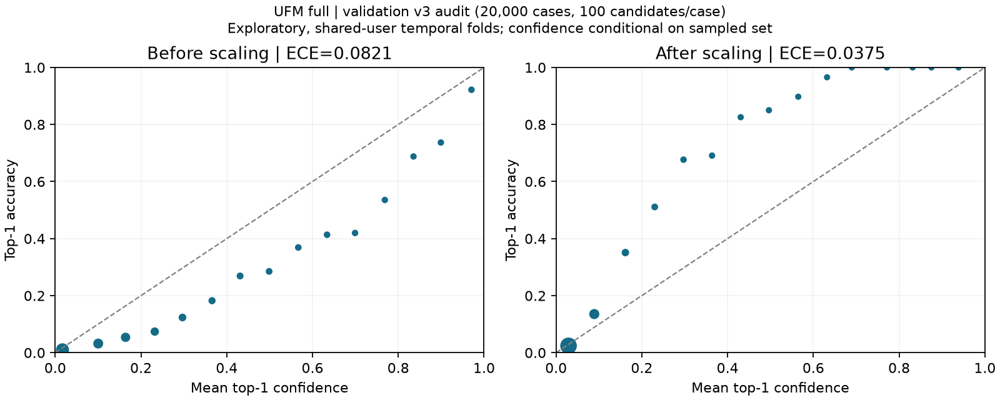

Temperature scaling giảm ECE hơn một nửa. Vì phép chia cho $T$ không đổi thứ tự, NDCG, Recall và MRR giữ nguyên. Kết quả mang tính thăm dò vì checkpoint đã được chọn trên validation và hai nửa có thể chung người dùng. Xác suất ở đây là độ tin cậy có điều kiện trên 100 ứng viên, không phải xác suất mua hàng; ECE giảm cũng không chứng minh hai đầu ước lượng độ bất định cải thiện xếp hạng.

#### 5.9. Kết quả trên các giao thức cũ

Các kết quả dưới đây được giữ để minh bạch lịch sử dự án. Chúng dùng bộ ứng viên khác v3 nên **không so sánh trực tiếp** với các bảng ở mục 5.3–5.8.

*Bảng: Kết quả lịch sử trên validation v1 (giao thức cũ)*

| Nhóm | UFM full | TF-IDF | Chênh lệch |
| --- | ---: | ---: | ---: |
| Zero-shot | 0,188403 | 0,186491 | +0,001912 |
| Extreme cold | 0,113300 | 0,191555 | −0,078255 |
| Cold | 0,189511 | 0,195763 | −0,006252 |
| Warm | 0,651231 | 0,467661 | +0,183570 |

Trên v1, UFM có NDCG nhóm ấm rất cao (0,651231). Con số này phản ánh cách lấy mẫu âm cũ chứ không phải chất lượng thật: khi mẫu âm được lấy cùng nhóm với đích ở v2 và v3, nhóm ấm của UFM full chỉ còn khoảng 0,11. Đây là lý do nhóm không dùng v1 để so sánh, chỉ dùng để chọn checkpoint như đã khóa từ trước. Trên v1, nhiệt độ hiệu chuẩn là 1,789353 và ECE giảm từ 0,164477 xuống 0,041497; khoảng tin cậy bootstrap 95% theo người dùng của chênh lệch cold macro UFM − TF-IDF là [−0,0302; −0,0251]. Nguồn: [audit lịch sử](../reports/ufm_validation_audit_v2/report.md).

*Bảng: UFM full trên bộ ứng viên evaluation v2 (kết quả lịch sử)*

| Nhóm | Số ca mỗi tập | Validation NDCG@10 | Test NDCG@10 |
| --- | ---: | ---: | ---: |
| Zero-shot | 10.000 | 0,156641 | 0,157281 |
| Extreme cold | 10.000 | 0,191567 | 0,195261 |
| Cold | 10.000 | 0,197946 | 0,198373 |
| Warm | 10.000 | 0,110375 | 0,113859 |
| **Cold macro** | 30.000 | **0,182051** | **0,183638** |
| **Overall** | 40.000 | **0,164132** | **0,166193** |

Trên v2, TF-IDF đạt Overall/Cold macro 0,181498 / 0,195672 và popularity 0,040904 / 0,042527, đều trên validation. Điểm của UFM trên validation và test v2 rất gần nhau, cho thấy kết quả validation không bị thổi phồng mạnh so với dữ liệu ở giai đoạn sau; tuy vậy test v2 đã được xem nên không còn là tập kiểm tra độc lập. Nguồn: [`reeval_ufm_full_v1_v2.json`](../reports/ufm_evaluation_v2_20261027/reeval_ufm_full_v1_v2.json).

Đối chứng BPR-MF được huấn luyện với ba seed (42, 7, 2026), mỗi seed 5 epoch, trên giao thức v1. Overall NDCG@10 đạt 0,135465 ± 0,000231 (độ lệch chuẩn mẫu), nhóm ấm 0,501055 ± 0,000466, nhưng cold macro chỉ 0,013602 ± 0,000233, đúng như kỳ vọng với một mô hình không có biểu diễn cho sản phẩm mới. Độ lệch chuẩn rất nhỏ giữa các seed của BPR-MF không thể chuyển sang UFM, vốn có kiến trúc và quá trình huấn luyện khác. SASRec và BERT4Rec thích nghi cũng đã có kết quả lịch sử trên v1, nhưng chưa được đánh giá lại trên v3 nên không đưa vào bảng chính.

#### 5.10. Baseline trên bộ dữ liệu All Beauty

*Bảng: Baseline popularity và TF-IDF trên validation All Beauty*

| Nhóm | Số ca | Popularity NDCG@10 | TF-IDF NDCG@10 | Popularity Recall@10 | TF-IDF Recall@10 |
| --- | ---: | ---: | ---: | ---: | ---: |
| Zero-shot | 10.000 | 0,000000 | 0,027645 | 0,000000 | 0,039500 |
| Extreme cold | 10.000 | 0,001102 | 0,020921 | 0,003700 | 0,030300 |
| Cold | 7.381 | 0,246404 | 0,246271 | 0,673621 | 0,652486 |
| Warm | 10.000 | 0,770103 | 0,742460 | 1,000000 | 0,967500 |
| **Overall** | **37.381** | **0,254963** | **0,260239** | **0,401514** | **0,406329** |

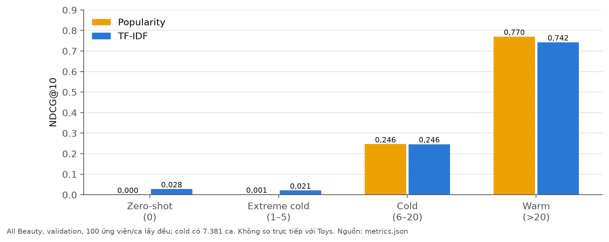

All Beauty dùng giao thức lấy mẫu khác Toys: 100 ứng viên/ca với mẫu âm lấy đều không hoàn lại, nhóm lạnh gồm toàn bộ 7.381 ca sẵn có. Vì mẫu âm không cùng nhóm với đích, popularity đạt rất cao ở nhóm ấm, và các con số không so sánh trực tiếp với Toys. Chỉ 2.627 trên 37.381 ca có lịch sử; trên nhóm này TF-IDF đạt 0,278014 so với 0,202934 của popularity. Kết quả cho thấy nội dung văn bản có ích cho sản phẩm mới ở miền thứ hai, nhưng đây mới là baseline tham chiếu, chưa phải kết quả của UFM.

#### 5.11. Tài nguyên và hiệu năng

**Huấn luyện.** Lượt UFM full mất khoảng 4,13 giờ cho tiến trình cuối trên Quadro RTX 6000 24 GB, với 198.232 bước. Checkpoint tốt nhất (chỉ trọng số) có dung lượng 396,7 MB; checkpoint mới nhất có thêm trạng thái bộ tối ưu nên lớn khoảng 1,19 GB. Ma trận TF-IDF chiếm 532 MB trên đĩa. Đỉnh VRAM của lượt huấn luyện chưa được đo riêng, nên đồ án không đưa ra cam kết chạy được trên GPU 16 GB.

**Suy luận trên catalog.** Demo chạy UFM trên CPU của một máy Windows (8 luồng, 16 GB RAM), chấm điểm toàn bộ 767.045 sản phẩm cho mỗi yêu cầu.

*Bảng: Đo độ trễ demo UFM trên CPU (2 lượt khởi động, 10 lượt đo, lịch sử 1 sản phẩm, K = 5)*

| Chỉ số | Giá trị |
| --- | ---: |
| Độ trễ p50 | 21,25 giây |
| Độ trễ p95 | 26,35 giây |
| Nhỏ nhất / lớn nhất | 19,25 / 28,44 giây |
| Thông lượng tuần tự | 0,0457 yêu cầu/giây |
| Bộ nhớ tiến trình (RSS) lúc khởi động / cao nhất | 2.512,6 / 2.551,5 MiB |
| Hai yêu cầu đồng thời | Một trả 200, một trả 429 |

Nguồn: [`windows_ufm_benchmark.json`](../reports/continuation_20261028/windows_ufm_benchmark.json). Máy chủ chỉ cho phép một lượt suy luận tại một thời điểm và trả HTTP 429 cho yêu cầu đến sau, thay vì để hai lượt tranh tài nguyên. Mười lượt đo chưa đủ để ước lượng p99 ổn định. Độ trễ hơn 20 giây là điểm yếu lớn nhất của demo; nguyên nhân chính là phải chấm điểm toàn catalog bằng mô hình phụ thuộc ứng viên trên CPU. Hướng cải thiện là truy hồi một tập ứng viên nhỏ trước rồi mới xếp hạng lại bằng UFM (mục 7.3).

#### 5.12. Thảo luận

**Vì sao TF-IDF mạnh?** Sản phẩm đồ chơi có nhiều từ khóa đặc thù như tên thương hiệu, tên dòng sản phẩm, số hiệu bộ, nhân vật bản quyền. TF-IDF với cặp từ bắt rất tốt các trùng khớp chính xác này. Trong khi đó, bộ mã hóa văn bản của CLIP chỉ đọc 77 token đầu, quá ngắn so với độ dài trung bình 985,73 ký tự của văn bản sản phẩm, và CLIP được huấn luyện cho chú thích ảnh chứ không cho mô tả thương mại. CLIP lại có lợi thế ở nhóm cực lạnh, nơi semantic-only vượt TF-IDF.

**Vì sao mô hình đầy đủ chưa vượt semantic-only?** Phân tích ở mục 5.6 cho thấy phần thua tập trung ở sản phẩm có 1–5 tương tác. Proxy độ tin cậy được thiết kế để giảm trọng số nhánh hành vi khi nó kém tin cậy, nhưng kết quả cho thấy nó chưa làm điều đó đủ mạnh ở nhóm này. Mặt khác, ở nhóm từ 6 tương tác trở lên, nhánh hành vi đã mang lại lợi ích rõ (+0,030183 ở nhóm 21+ trên ca có lịch sử). Điều này gợi ý rằng ý tưởng hợp nhất theo độ tin cậy có cơ sở, nhưng cần thêm thông tin về số tương tác của ứng viên, đúng hướng của hai can thiệp đã cài đặt.

**Các mối đe dọa đến tính hợp lệ.** (1) Một seed huấn luyện: các chênh lệch nhỏ hơn khoảng 0,005 không đủ cơ sở kết luận. (2) Validation v3 dùng lại quần thể đã chọn checkpoint. (3) Mẫu âm hồi cứu và tập 100 ứng viên không đại diện cho xếp hạng toàn catalog. (4) Metadata là ảnh chụp tại thời điểm công bố dữ liệu. (5) Các ca không độc lập vì có thể chung người dùng. Những giới hạn này không làm mất giá trị của kết quả, nhưng quy định cách diễn giải: đây là bằng chứng thăm dò, có tính so sánh nội bộ, không phải khẳng định về hiệu năng triển khai thực tế.

---

### CHƯƠNG 6: HỆ THỐNG DEMO

#### 6.1. Mục tiêu và kiến trúc

Ứng dụng demo cho phép người xem tự tạo một lịch sử mua sắm và xem mô hình gợi ý gì, đặc biệt với sản phẩm chưa từng có tương tác. Yêu cầu quan trọng nhất là **trung thực**: demo phải chạy mô hình thật trên catalog thật, và nói rõ khi nào nó đang chạy chế độ minh họa. Demo gồm ba thành phần:

- **Lõi suy luận** (`src/recommend_catalog.py`): lớp `Catalog` nạp 767.045 sản phẩm, số tương tác train, tìm kiếm theo tên hoặc mã ASIN và xác định nhóm của từng sản phẩm; lớp `UFMBackend` nạp checkpoint, mã nguồn huấn luyện đã lưu trữ kèm mã băm và bảng đặc trưng CLIP, rồi chấm điểm toàn catalog theo từng khối 1.024 sản phẩm; lớp `ContentBackend` là chế độ dự phòng dùng TF-IDF.
- **Máy chủ HTTP** (`src/demo_recommender.py`): chỉ lắng nghe trên địa chỉ nội bộ (loopback), kiểm tra nguồn gọi (origin) và chỉ xử lý một lượt suy luận tại một thời điểm.
- **Giao diện web** (`demo/index.html`): một trang HTML duy nhất với giao diện tối.

*Bảng: Các API của máy chủ demo*

| Phương thức | Đường dẫn | Chức năng |
| ------ | --------------- | ------------------------ |
| GET | `/api/status` | Trạng thái, tên backend, cảnh báo, mã băm checkpoint, nguồn đặc trưng, số sản phẩm |
| GET | `/api/examples` | Một số sản phẩm phổ biến để bắt đầu |
| GET | `/api/search?q=` | Tìm sản phẩm theo tên hoặc mã ASIN |
| GET | `/api/product-image?asin=` | Ảnh sản phẩm lưu cục bộ (chế độ mẫu) |
| POST | `/api/recommend` | Nhận lịch sử (tối đa 20 ASIN), số lượng K và bộ lọc nhóm; trả danh sách gợi ý |

Mỗi kết quả trả về gồm mã ASIN, tên, ảnh, số tương tác train, nhóm, điểm xếp hạng, cặp trọng số [hành vi, ngữ nghĩa], cặp độ bất định và cờ phương thức. Kèm theo mỗi phản hồi là mã băm của checkpoint, mã nguồn huấn luyện và đặc trưng đã dùng, để kết quả trên màn hình truy được về đúng mô hình.

#### 6.2. Giao diện và luồng sử dụng

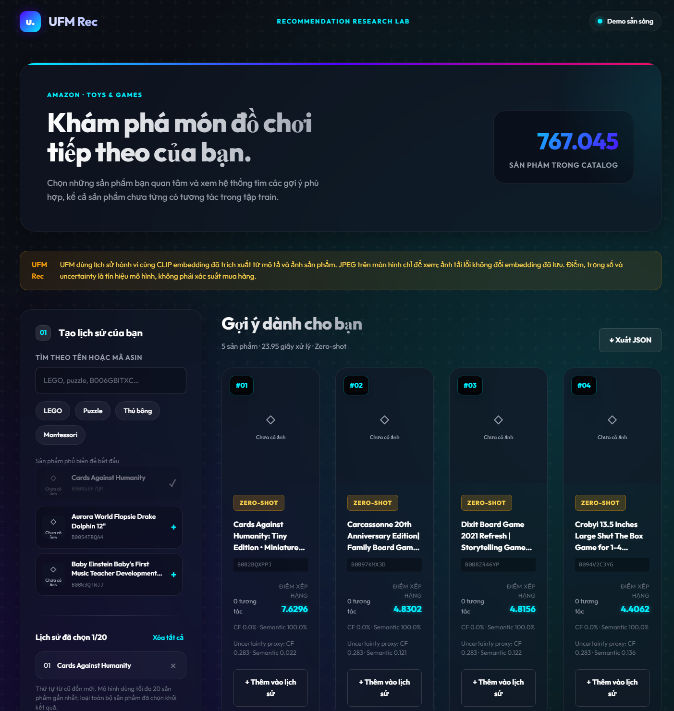

Người dùng thao tác theo ba bước, tương ứng ba khối trên giao diện:

1. **Tạo lịch sử:** tìm sản phẩm theo tên hoặc mã (có gợi ý nhanh như LEGO, Puzzle, Thú bông, Montessori), thêm tối đa 20 sản phẩm vào lịch sử. Thứ tự từ cũ đến mới; mô hình dùng tối đa 20 sản phẩm gần nhất và loại các sản phẩm đã chọn khỏi kết quả.
2. **Chọn cách khám phá:** chọn nhóm sản phẩm muốn xem (tất cả, zero-shot, cực lạnh, lạnh, ấm) và số kết quả K, rồi bấm "Tìm gợi ý cho tôi".
3. **Xem và so sánh:** mỗi thẻ kết quả hiển thị ảnh, nhóm, số tương tác, điểm xếp hạng, tỷ lệ trọng số hành vi/ngữ nghĩa và proxy độ bất định. Người xem có thể thêm kết quả vào lịch sử để thử tiếp, hoặc xuất toàn bộ kết quả ra tệp JSON để trình bày.

Một dải cảnh báo luôn hiển thị phía trên, nói rõ điểm số, trọng số và độ bất định là tín hiệu của mô hình, không phải xác suất mua hàng, và ảnh trên màn hình chỉ để xem: mô hình dùng đặc trưng CLIP đã trích xuất sẵn, nên ảnh tải lỗi không làm đổi điểm. Với gợi ý zero-shot như trong hình, trọng số luôn là 0% hành vi và 100% ngữ nghĩa, đúng với thiết kế ở mục 4.4.

#### 6.3. Chế độ dự phòng và catalog mẫu

Bộ đầy đủ để chạy UFM (checkpoint, đặc trưng CLIP, catalog) có dung lượng lớn và nằm ngoài Git. Để demo vẫn chạy được trên máy không có dữ liệu, trình khởi động `Start_Demo.cmd` tự chọn backend: dùng UFM khi tìm thấy checkpoint hoàn tất cùng dữ liệu đúng mã băm, ngược lại dùng chế độ nội dung (TF-IDF). Người trình bày cũng có thể chọn rõ bằng `Start_Demo.cmd --backend ufm` hoặc `--backend content`.

Ở chế độ nội dung, nếu thiếu catalog, trình khởi động tự dựng một **catalog mẫu 30 sản phẩm** thật của Toys & Games, kèm ảnh lưu cục bộ trong `demo/demo_images/` và nguồn URL, mã băm trong `demo/catalog_products.json`. Số tương tác của catalog mẫu là **mô phỏng** để có đủ bốn nhóm; giao diện và phản hồi API ghi rõ điều này (`counts_simulated = true`) để người xem không nhầm với kết quả của mô hình thật.

#### 6.4. Nghiệm thu API và giao diện

Demo UFM được nghiệm thu trên máy Windows ngày 29/10/2026 với checkpoint epoch 9 (SHA-256 bắt đầu bằng `5630013d`), catalog 767.045 sản phẩm và số tương tác thật.

*Bảng: Sáu ca nghiệm thu API trên catalog thật*

| Ca | Yêu cầu | Kết quả | Thời gian |
| --------- | ------------ | --------------- | -----: |
| Không lịch sử | Lịch sử rỗng, K = 5 | Đạt: trả gợi ý theo popularity | 14,8 giây |
| Có lịch sử | 1 sản phẩm, mọi nhóm | Đạt | 16,2 giây |
| Zero-shot | 1 sản phẩm, lọc zero-shot | Đạt: trọng số [0; 1], nhóm đúng | 8,4 giây |
| Extreme cold | 1 sản phẩm, lọc cực lạnh | Đạt | 10,6 giây |
| Cold | 1 sản phẩm, lọc lạnh | Đạt | 7,5 giây |
| Warm | 1 sản phẩm, lọc ấm | Đạt | 6,2 giây |

Yêu cầu có lọc nhóm nhanh hơn vì chỉ chấm điểm sản phẩm thuộc nhóm đó. Ngoài sáu ca trên, một lịch sử chỉ gồm mã sản phẩm không tồn tại bị từ chối với **HTTP 400** ("Unknown ASIN"), thay vì âm thầm trả gợi ý như người dùng không có lịch sử. Các ca thiếu phương thức cũng được kiểm tra: lịch sử chứa sản phẩm chỉ có văn bản hoặc chỉ có ảnh vẫn trả gợi ý đúng; ảnh cục bộ không tồn tại trả 404 có kiểm soát.

*Bảng: Bốn ca nghiệm thu giao diện bằng Chrome chạy tự động*

| Ca | Nội dung kiểm tra | Kết quả |
| --------- | ------------------------ | ------ |
| Giao diện sẵn sàng | Hiển thị backend "UFM Rec", 767.045 sản phẩm, tìm kiếm trả kết quả | Đạt |
| Zero-shot và ảnh lỗi | Chọn lịch sử, lọc zero-shot, Top 5; ảnh không tải được vẫn có ô thay thế | Đạt |
| Xuất JSON | Tệp tải về khớp yêu cầu, mô hình và Top 5 trên màn hình | Đạt |
| Mất kết nối | Hiện thông báo lỗi, khóa nút xuất, làm mờ kết quả cũ | Đạt |

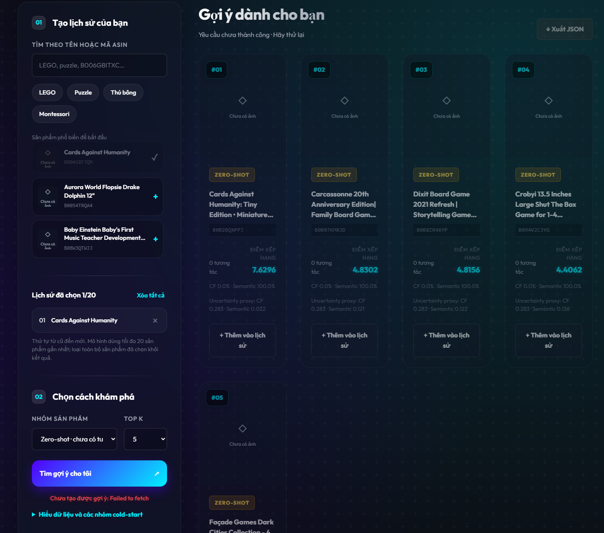

Bằng chứng gồm phản hồi API đầy đủ, ảnh chụp màn hình và tệp JSON tải về, lưu trong `reports/nontraining_20261029/`. Đây là nghiệm thu tự động trên một máy; trước buổi bảo vệ, nhóm cần chạy lại các ca này trên máy trình chiếu.

#### 6.5. Hướng dẫn chạy

Trên máy có bản sao dữ liệu đầy đủ, mở `Start_UFM_From_Backup.cmd` trong thư mục sao lưu; trình khởi động in ra địa chỉ cục bộ để mở bằng trình duyệt. Trên máy khác, mở `Start_Demo.cmd` trong thư mục dự án để chạy chế độ nội dung với catalog mẫu. Trước khi trình bày, kiểm tra nhãn backend trên giao diện: "UFM Rec" nghĩa là đang chạy mô hình thật trên toàn catalog. Vì một lượt gợi ý trên toàn catalog mất khoảng 20 giây trên CPU, nên chuẩn bị sẵn lịch sử và dùng bộ lọc nhóm để rút ngắn thời gian chờ; ảnh chụp kết quả thật được lưu sẵn làm phương án dự phòng.

---

### CHƯƠNG 7: KẾT LUẬN VÀ HƯỚNG PHÁT TRIỂN

#### 7.1. Kết luận

Đồ án đã xây dựng trọn vẹn một hệ khuyến nghị sản phẩm kết hợp lịch sử hành vi, văn bản và hình ảnh trên dữ liệu thật quy mô lớn: 11.572.689 tương tác, 6.158.534 người dùng và 767.045 sản phẩm của Amazon Reviews 2023 Toys & Games. Hệ thống gồm quy trình dữ liệu chia theo thời gian, đặc trưng CLIP cho 767.044 văn bản và 758.692 ảnh, mô hình UFM-Rec hai nhánh có hợp nhất theo proxy độ tin cậy, mười mô hình và biến thể được đánh giá trên cùng một bộ ứng viên có mã băm, hiệu chuẩn điểm số và một ứng dụng demo chạy trên toàn catalog.

Trả lời các câu hỏi nghiên cứu ở mục 1.4:

- **CH1.** Đặc trưng CLIP đóng băng cho kết quả tốt ở sản phẩm lạnh: semantic-only đạt cold macro NDCG@10 0,190036, cao nhất ở nhóm cực lạnh (0,215668). Văn bản đóng vai trò chính; ảnh đứng riêng yếu hơn (0,149632) nhưng giúp ở nhóm ấm. TF-IDF vẫn là đối chứng mạnh nhất về tổng thể (0,195682).
- **CH2.** UFM full (0,182056) chưa vượt semantic-only và TF-IDF. Nhánh hành vi có lợi cho sản phẩm có từ 6 tương tác trở lên (đến +0,030183 ở nhóm 21+ trên ca có lịch sử) nhưng gây hại ở nhóm 1–5 tương tác (−0,045933 trên ca có lịch sử).
- **CH3.** Văn bản và nhánh ngữ nghĩa là các thành phần không thể thiếu. Proxy độ tin cậy và căn chỉnh chéo chưa cho thấy lợi ích đo được với một seed; trọng số học được nhỉnh hơn trọng số cố định một cách nhất quán nhưng rất nhỏ.
- **CH4.** Mô hình gốc tự tin quá mức; temperature scaling với $T = 2{,}012405$ giảm ECE từ 0,082061 xuống 0,037478 mà không đổi thứ hạng.

Kết quả quan trọng nhất của đồ án vì vậy không phải một con số vượt đối chứng, mà là việc xác định được **chính xác vùng dữ liệu nơi việc dung hợp hành vi đang gây hại**, kèm hai can thiệp đã được cài đặt và kiểm thử để kiểm chứng. Về mặt kỹ thuật, nhóm đã tích lũy được quy trình thực nghiệm có thể tái lập và kiểm chứng: mã băm cho mọi đầu vào, tách bạch các phiên bản giao thức, sổ theo dõi việc mở tập test, huấn luyện chịu gián đoạn và sao lưu có kiểm tra.

#### 7.2. Hạn chế

1. **Một seed huấn luyện.** Mọi kết quả UFM đến từ seed 42; chưa đo được biến thiên giữa các lượt huấn luyện, nên các chênh lệch nhỏ chưa đủ cơ sở kết luận.
2. **Không có tập kiểm tra độc lập.** Validation v3 dùng lại quần thể đã chọn checkpoint; test v2 đã được xem.
3. **Đánh giá trên tập ứng viên lấy mẫu.** 100 ứng viên mỗi ca, mẫu âm hồi cứu theo nhóm; kết quả không tương đương xếp hạng toàn catalog hay thử nghiệm trực tuyến.
4. **Hai can thiệp chưa được huấn luyện.** `count_aware_fusion` và `adaptive_dropout` mới có mã và kiểm thử.
5. **Giới hạn của CLIP.** Bộ mã hóa văn bản chỉ đọc 77 token đầu của mô tả; CLIP được đóng băng nên không thích nghi với miền đồ chơi.
6. **Độ trễ demo cao.** Khoảng 21 giây mỗi lượt trên CPU khi chấm toàn catalog.
7. **Một miền dữ liệu.** All Beauty mới có dữ liệu và baseline; chưa có UFM.

#### 7.3. Hướng phát triển

Hướng ưu tiên nhất là kiểm chứng giả thuyết ở mục 5.6 bằng kế hoạch huấn luyện đã được khóa trong [`configs/multimodal_followup_20261028.json`](../configs/multimodal_followup_20261028.json):

*Bảng: Kế hoạch 15 lượt huấn luyện đã khóa*

| Giai đoạn | Biến thể | Seed | Số lượt | Mục đích |
| --------- | --------------- | --------- | --------: | ------------------ |
| Đối chứng | full, semantic_only, fixed_fusion | 42, 7, 2026 | 9 | Đo biến thiên giữa các seed của ba mốc so sánh |
| Can thiệp 1 | count_aware_fusion | 42, 7, 2026 | 3 | Kiểm chứng việc phạt nhánh hành vi theo số tương tác |
| Can thiệp 2 | adaptive_dropout | 42, 7, 2026 | 3 | Kiểm chứng việc bỏ ID theo tần suất |

Mọi lượt dùng cùng siêu tham số ở Bảng 4.1, cùng quy tắc dừng sớm và chọn checkpoint theo cold macro NDCG@10 trên validation v1; không chọn theo v3 hay test. Báo cáo phải gồm từng seed, trung bình và độ lệch chuẩn mẫu cho cold macro và từng nhóm, kể cả khi can thiệp không cải thiện. Script chạy (`scripts/run_locked_ufm_followup.py`) kiểm tra 9 đầu vào theo mã băm trước khi chạy; hai notebook Colab (`notebooks/UFM_Colab_Browser_Train.ipynb` cho trình duyệt, T4 mặc định hoặc L4, và `notebooks/UFM_Colab_Train.ipynb` cho VS Code) hỗ trợ huấn luyện theo đoạn, sao lưu lên Google Drive có kiểm SHA-256 và tiếp tục sau khi phiên bị ngắt. Mỗi epoch có khoảng 16.520 bước, nên cần đo tốc độ thực tế trên GPU Colab trước khi lập lịch cho đủ 15 lượt.

Các hướng tiếp theo, theo thứ tự ưu tiên:

1. **Phân tích cổng và độ bất định** trên checkpoint thật cho nhóm 1–5 tương tác, để biết cổng phân bổ trọng số thế nào trước và sau can thiệp.
2. **Đánh giá trên tập kiểm tra độc lập** được thống nhất trước khi mở nhãn, chỉ dùng một lần cho mô hình đã chọn trên validation.
3. **Truy hồi rồi xếp hạng lại:** dùng một bước truy hồi nhanh (ví dụ tìm láng giềng gần đúng trên vector ngữ nghĩa) để chọn vài trăm ứng viên rồi mới chấm bằng UFM, kèm đo recall của bước truy hồi, chất lượng cuối và độ trễ.
4. **Bộ mã hóa văn bản dài hơn hoặc tinh chỉnh nhẹ** (ví dụ LoRA) để khắc phục giới hạn 77 token của CLIP.
5. **Huấn luyện UFM trên All Beauty** để kiểm chứng trên miền thứ hai.

---

### Tài liệu tham khảo

1. Radford, A. và cộng sự (2021). [Learning Transferable Visual Models From Natural Language Supervision](https://arxiv.org/abs/2103.00020). ICML 2021. Nguồn của CLIP; đề tài dùng encoder đóng băng, không tinh chỉnh.
2. Kang, W.-C. và McAuley, J. (2018). [Self-Attentive Sequential Recommendation](https://arxiv.org/abs/1808.09781). ICDM 2018. Tham chiếu SASRec; bản trong repo là bản thích nghi, không phải tái lập chuẩn.
3. Sun, F. và cộng sự (2019). [BERT4Rec: Sequential Recommendation with Bidirectional Encoder Representations from Transformer](https://arxiv.org/abs/1904.06690). CIKM 2019.
4. Rendle, S. và cộng sự (2009). [BPR: Bayesian Personalized Ranking from Implicit Feedback](https://arxiv.org/abs/1205.2618). UAI 2009.
5. Guo, C. và cộng sự (2017). [On Calibration of Modern Neural Networks](https://proceedings.mlr.press/v70/guo17a.html). ICML 2017. Tham chiếu temperature scaling.
6. Hou, Y. và cộng sự (2024). [Bridging Language and Items for Retrieval and Recommendation](https://arxiv.org/abs/2403.03952). Bài báo công bố bộ dữ liệu [Amazon Reviews 2023](https://amazon-reviews-2023.github.io/) của McAuley Lab.
7. Vaswani, A. và cộng sự (2017). [Attention Is All You Need](https://arxiv.org/abs/1706.03762). NeurIPS 2017.
8. Dosovitskiy, A. và cộng sự (2021). [An Image is Worth 16x16 Words: Transformers for Image Recognition at Scale](https://arxiv.org/abs/2010.11929). ICLR 2021. Kiến trúc ViT dùng trong bộ mã hóa ảnh của CLIP.
9. Koren, Y., Bell, R. và Volinsky, C. (2009). Matrix Factorization Techniques for Recommender Systems. IEEE Computer, 42(8), 30–37.
10. Krichene, W. và Rendle, S. (2020). [On Sampled Metrics for Item Recommendation](https://doi.org/10.1145/3394486.3403226). KDD 2020.
11. Järvelin, K. và Kekäläinen, J. (2002). Cumulated Gain-Based Evaluation of IR Techniques. ACM Transactions on Information Systems, 20(4), 422–446.
12. Kendall, A. và Gal, Y. (2017). [What Uncertainties Do We Need in Bayesian Deep Learning for Computer Vision?](https://arxiv.org/abs/1703.04977). NeurIPS 2017.
13. Salton, G. và Buckley, C. (1988). Term-Weighting Approaches in Automatic Text Retrieval. Information Processing & Management, 24(5), 513–523.
14. Schein, A. I. và cộng sự (2002). Methods and Metrics for Cold-Start Recommendations. SIGIR 2002.
15. Loshchilov, I. và Hutter, F. (2019). [Decoupled Weight Decay Regularization](https://arxiv.org/abs/1711.05101). ICLR 2019. Bộ tối ưu AdamW.
16. Micikevicius, P. và cộng sự (2018). [Mixed Precision Training](https://arxiv.org/abs/1710.03740). ICLR 2018.
17. Paszke, A. và cộng sự (2019). [PyTorch: An Imperative Style, High-Performance Deep Learning Library](https://arxiv.org/abs/1912.01703). NeurIPS 2019.
18. Pedregosa, F. và cộng sự (2011). Scikit-learn: Machine Learning in Python. Journal of Machine Learning Research, 12, 2825–2830.

---

### PHỤ LỤC

#### A. Cấu trúc mã nguồn và tài liệu

*Bảng: Cấu trúc thư mục của dự án*

| Thư mục | Nội dung |
| ------ | --------------------- |
| `src/` | Mô hình UFM-Rec, quy trình dữ liệu, huấn luyện, đánh giá, đối chứng và lõi demo |
| `scripts/` | Công cụ phụ trợ: kế hoạch đa seed, sao lưu, đo tài nguyên, dựng hình và báo cáo |
| `tests/` | 123 ca kiểm thử pytest |
| `configs/` | Giao thức đánh giá v2 và kế hoạch 15 lượt huấn luyện đã khóa |
| `notebooks/` | Notebook Colab cho vòng huấn luyện tiếp theo, notebook giám sát FITLAB, notebook All Beauty |
| `demo/` | Giao diện web và catalog mẫu 30 sản phẩm |
| `data/` | Manifest và báo cáo nhỏ của dữ liệu; dữ liệu lớn nằm ngoài Git |
| `reports/` | Bằng chứng thực nghiệm có mã băm, biên nhận nghiệm thu và sao lưu |
| `docs/` | Nguồn của báo cáo, slide và các hướng dẫn vận hành |
| `output/` | Bản Word, PDF, slide hiện hành; `output/history/` chứa các bản cũ |

#### B. Lệnh tái lập chính

Các lệnh dưới đây chạy từ thư mục gốc của dự án. Hai lệnh dựng tài liệu chỉ đọc bằng chứng đã lưu, không huấn luyện lại.

```text
python -m pytest tests/ -q
python scripts/build_current_evidence.py
python scripts/build_report_figures.py
python scripts/build_school_report_docx.py
Start_Demo.cmd --backend content
python scripts/run_locked_ufm_followup.py
```

Lệnh cuối mặc định chỉ kiểm tra trước (preflight) 9 đầu vào theo mã băm và liệt kê 15 lượt; chỉ chạy huấn luyện thật khi thêm tùy chọn `--execute` trên máy có GPU phù hợp.

#### C. Bằng chứng chính và mã băm

*Bảng: Các tệp bằng chứng chính của báo cáo*

| Nội dung | Tệp | Mã băm (rút gọn) |
| --------- | --------------------- | --------- |
| Bộ ứng viên validation v3 | `reports/fix_1_15_20261027/fitlab01_finish1/evaluation_v3/samples_validation.npz` (bản sao lưu) | `9387e66e…` |
| Checkpoint UFM full epoch 9 | `runs/ufm_full_v1/best.pt` | `5630013d…` |
| Bảng tổng hợp mười mô hình | `reports/nontraining_20261029/evidence.json` | ghi kèm mã băm nguồn |
| Lịch sử huấn luyện 12 epoch | `reports/final_20261103/ufm_full_v1_training_history.json` | ghi kèm mã băm từng epoch |
| Nghiệm thu demo | `reports/nontraining_20261029/demo_api_verification.json` | ghi kèm mã băm checkpoint |
| Sao lưu và khôi phục | `reports/continuation_20261028/backup_receipts.json` | 796 tệp đã đối chiếu SHA-256 |
