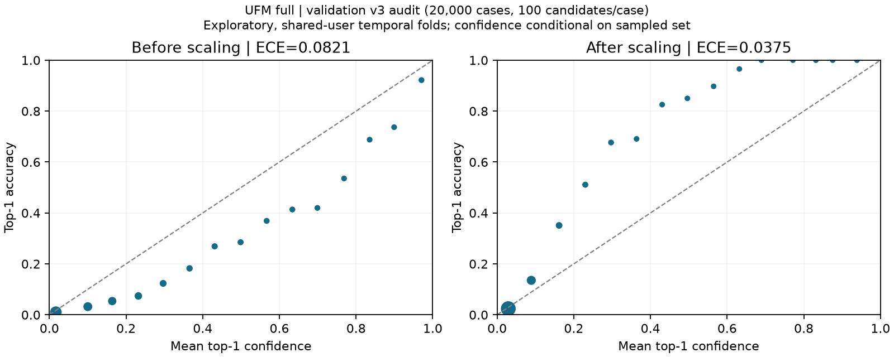
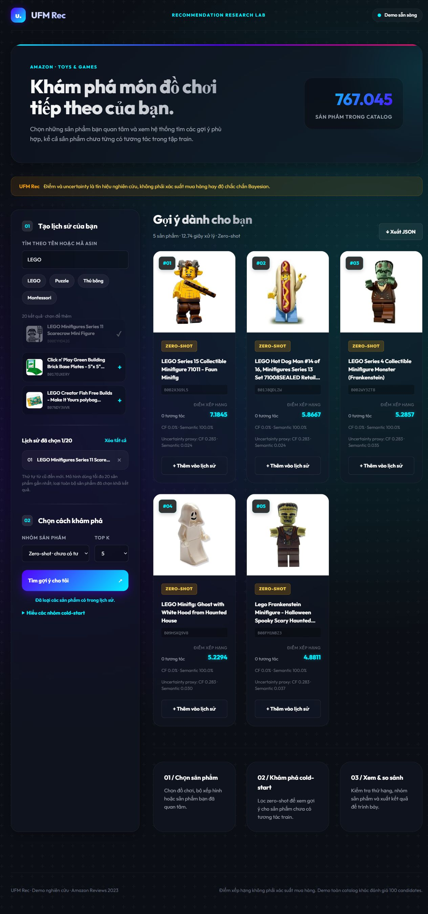

# Kết quả tiếp tục ngày 28/10/2026

Phạm vi hệ gợi ý sản phẩm dùng hành vi, hình ảnh và tên/mô tả đã được nhóm xác nhận với giảng viên. Bản [giao thức cho vòng tiếp theo](../../configs/multimodal_followup_20261028.json) khóa ba seed, ba đối chứng và hai cải tiến đánh giá riêng; **15 run mới chưa được huấn luyện**. Máy local không có CUDA và phiên FITLAB chưa truy cập được để khởi chạy. Những số dưới đây vẫn là checkpoint lịch sử một seed.

Checkpoint UFM đã được nạp từ bản sao local trên Windows: catalog 767.045 item, counts thật, checkpoint SHA `5630013d0cbb6db633c4f4cf5bcd840fb703dbfc64a13c0352278624e03e11c8`. [Sáu ca API Windows](windows_ufm_verification.json) đều đạt: no-history, history, zero-shot, extreme-cold, cold, warm; bộ lọc và loại item lịch sử được kiểm tra. Đây là bằng chứng vận hành, không phải metric chất lượng.

[Benchmark HTTP trên Windows](windows_ufm_benchmark.json) dùng 2 warm-up và 10 request đo trên catalog đầy đủ, một ASIN lịch sử, K=5. p50 **21,25 giây**, p95 **26,35 giây**, RSS server cao nhất quan sát **2.551,5 MiB**. Hai request cùng lúc trả một 200 và một 429 vì khóa suy luận một lượt. Sequential QPS khoảng **0,0457** trên máy đo này; không gọi đó là throughput đồng thời hoặc peak RAM train. Hiệu năng hiện chậm cho trải nghiệm tương tác; cần tối ưu retrieval/caching sau khi kết quả mô hình ổn định.

[Kiểm tra thiếu modality Windows](windows_ufm_missing_modalities.json) chọn một ASIN chỉ có text và một ASIN chỉ có ảnh từ mask CLIP thật. Cả hai tìm kiếm được, dùng làm history rồi trả Top 3 hữu hạn và loại ASIN đã chọn. Cache có 8.353 item chỉ text, 1 item chỉ ảnh, không có item thiếu cả hai. Endpoint JPEG local thiếu trả 404; mô hình vẫn dùng embedding đã lưu. [Giao diện Chrome local](windows_ufm_ui_visual_check.json) đã tìm LEGO, thêm một item vào history và trả Top 5 zero-shot; năm ảnh kết quả đều tải được. Lượt xuất JSON local chưa xác minh được file tải, còn xuất JSON trên FITLAB đã có receipt riêng.

Phân tích [dự đoán v3 theo train count](count_effect_v3.json) đối chiếu SHA của candidates, scores và counts. Full − semantic-only NDCG@10: count 0 **−0,002424**, 1–5 **−0,024101**, 6–20 **+0,002586**, 21+ **+0,014865** (mỗi nhóm 10.000 ca). Trong các ca 1–5 có history, chênh lệch là **−0,045933** trên 5.247 ca; không có history thì hai checkpoint cho cùng điểm ở nhóm này. Đây là phân tích mô tả của dự đoán đã lưu, chưa cô lập được tác động nhân quả của ID hay gate.

Nguồn: [toàn bộ kết quả v3](validation_v3_results.json), [tóm tắt máy đọc](summary.json), [audit validation v1](saved_validation_v1_audit.json).

## Validation v3 đã hoàn tất

17/17 bước thành công: popularity/TF-IDF, tám checkpoint UFM và tám lượt calibration. Mỗi mô hình dùng cùng 40.000 ca, 1 positive + 99 negative. Seed huấn luyện: 42. Checkpoint đã chọn từ validation v1; v3 là đánh giá lại, chưa phải holdout độc lập. Lượt này chỉ đọc validation, không đánh giá thêm test.

`samples_validation.npz` SHA-256: `9387e66e9f1905c44d02b65c3809f5fa8b6c022f6abf0c1a37d52cb57767a60e`.

Cold macro NDCG@10 (trung bình zero-shot, extreme-cold, cold):

- `tfidf_profile`: **0.195682**.
- `ufm_ablation_semantic_only_s42_v1`: **0.190036**.
- `ufm_ablation_no_cross_align_s42_v1`: **0.183393**.
- `ufm_ablation_no_uncertainty_s42_v1`: **0.182253**.
- `ufm_full_v1`: **0.182056**.
- `ufm_ablation_text_only_s42_v1`: **0.181982**.
- `ufm_ablation_fixed_fusion_s42_v1`: **0.181305**.
- `ufm_ablation_image_only_s42_v1`: **0.149632**.
- `ufm_ablation_collaborative_only_s42_v1`: **0.070003**.
- `popularity`: **0.042527**.

Full UFM thấp hơn semantic-only và TF-IDF trên giao thức này. Kết quả chưa xác nhận lợi ích của gate/uncertainty đối với chỉ số chính. Một seed chưa đo được biến thiên giữa các lần huấn luyện; không coi bootstrap theo user là thay thế nhiều seed.

TF-IDF dùng 10 history item, UFM dùng 20; đây là benchmark hệ thống. Các biến thể UFM dùng cùng CLIP và history.

## Calibration thăm dò của full UFM

Fit 20,000 ca validation sớm; audit 20,000 ca muộn, giữ các timestamp bằng nhau cùng phía. T = 2.012405; ECE 0.082061 → 0.037478; NLL 4.497667 → 4.258086.

Đây là confidence có điều kiện trên 100 ứng viên đã lấy mẫu, không phải xác suất mua. Checkpoint từng dùng validation để chọn; các phần theo thời gian có thể chung user. Temperature scaling không thay đổi thứ hạng. Các số calibration lịch sử v1 giữ riêng.

## Bằng chứng lịch sử đã xác minh

Audit v1 xác minh 10 lượt hoàn tất: full UFM, bảy ablation, SASRec và BERT4Rec. Các UFM ablation dùng cùng CLIP, code huấn luyện và ngân sách cấu hình. Tên run tuần tự có hậu tố v2 là phiên bản triển khai; predictions đã xác minh thuộc candidate v1. Chênh cold macro full − semantic-only trên v1 = −0,014931; paired user bootstrap 95% [−0,016918; −0,013001], 1.000 mẫu, 38.967 user. Không ghép metric v1 vào bảng v3.

SASRec/BERT4Rec là bản thích nghi trong repo, chưa phải reproduction chuẩn. Config đã lưu: history 20, 8 negatives, seed 42, tối đa 20 epoch, chọn bằng cold macro validation. SASRec dùng sampled positive/negative BCE. BERT4Rec dùng bidirectional Cloze (15% mask, thay thế 80/10/10, 10% force-last) và sampled softmax. ID chưa có tương tác train không có embedding được học; scoring ID-only dùng train-popularity fallback. Khác biệt objective với UFM phải được giữ khi diễn giải đối chứng.

## Phần còn phải nghiệm thu

- Sao lưu FITLAB: chỉ xem hoàn tất khi đủ 22 gói khớp hash và có restore receipt đầy đủ; theo dõi receipt ngoài repo.
- Demo UFM thật: giữ bằng chứng request/checkpoint/candidate regime và nghiệm thu giao diện.
- Nhiều seed và cải tiến count-aware/adaptive: chưa có kết quả train được xác minh.
- CI GitHub đã đạt Windows/Ubuntu cho [nhánh followup](https://github.com/anky06-ky/UFM-Rec/actions/runs/40693524511). Phạm vi ba tín hiệu đã được nhóm xác nhận với giảng viên; metric nghiệm thu và yêu cầu UFM All Beauty vẫn cần góp ý. Word/PDF báo cáo toàn văn chưa đồng bộ; [PDF tiến độ ngắn](../../output/pdf/UFM_Rec_Tien_Do_2026_10_28.pdf) đã được kiểm tra trực quan.

## Nghiệm thu phần mềm và demo

Kiểm thử cuối: Windows **93 passed, 3 skipped**, Linux **96 passed, 0 skipped**, cùng 10 subtests. Ba skip trên Windows dành cho Linux flock/procfs. Log: [Windows](windows_checks_final_20261028.log), [Linux](linux_checks_final_20261028.log).

Demo CPU dùng checkpoint full epoch 9 đã xác minh, catalog 767.045 sản phẩm và counts thật. **6/6 ca API đạt**: no-history, history, zero-shot, extreme-cold, cold, warm; kiểm tra trả weights/uncertainty, loại item đã chọn và đúng regime. [Bằng chứng từng request](demo_ufm_verification.json). Giao diện qua proxy FITLAB-01 đã tìm LEGO, chọn history và trả Top 5 zero-shot.

Sáu request đơn lẻ đo khoảng 11–53 giây trên CPU khi host có tải. Đây là số quan sát, chưa phải benchmark warm-up/p50/p95/throughput. Không sử dụng các số này như bằng chứng đạt mục tiêu latency. Ảnh catalog đầy đủ hiện dùng URL metadata; 30 ảnh demo local vẫn có chế độ offline.
